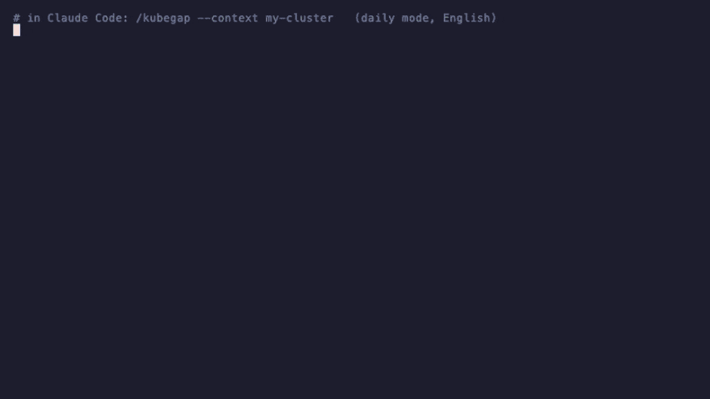
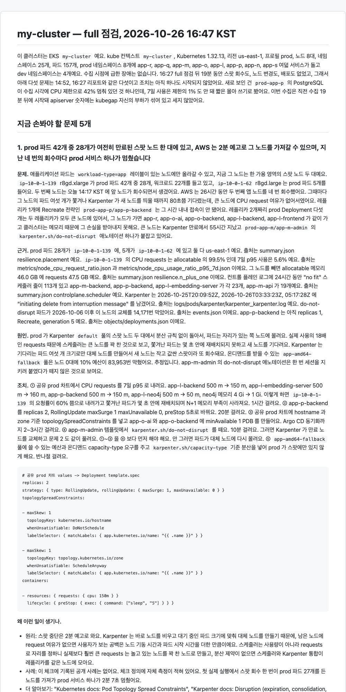
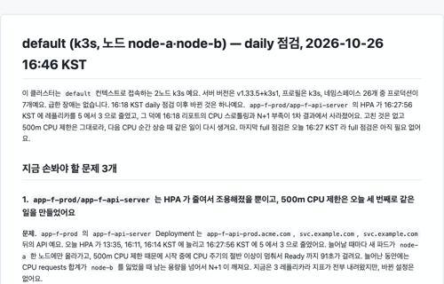

# kubegap

English: [README.md](README.md)

[](https://github.com/KyungHwanKim-devs/kubegap/actions/workflows/ci.yml) [](LICENSE)   

**오후 내내 클러스터를 뒤지는 대신, 아침에 리포트 5분만 읽으세요.**

클러스터 점검은 toil 입니다. Google 이 낸 『Site Reliability Engineering』 은 손으로 반복하고, 자동화할 수 있고, 서비스가 커질수록 같이 늘어나는 일을 toil 이라고 부르고, 그런 일을 줄이는 것이 SRE 의 본업이라고 말합니다. kubegap 은 점검이라는 toil 을 대신 맡습니다. 그렇게 아낀 시간은 엔지니어링에 쓰시면 됩니다.

kubegap 은 플랫폼이 다른 클러스터 세 개를 혼자 운영하면서 만들었습니다. 규모가 작은 k3s, 회사의 EKS, 그리고 고객사에서 맡고 있는 Azure 위의 Kubernetes 입니다. 알림과 대시보드는 미리 정해 둔 것만 잡아 줍니다. 그 바깥의 문제는 클러스터를 직접 뒤져야 보이는데, 세 곳을 매일 그렇게 들여다볼 시간은 없습니다. 그 일을 kubegap 이 대신합니다. 클러스터 상태를 읽어 와서 403개 기준으로 따져 보고, 사람이 읽을 리포트로 정리합니다.

kubegap 은 [Agent Skills](https://agentskills.io) 스킬입니다. Claude Code, Codex 같은 코딩 에이전트가 읽는 공개 규격이라, 그런 에이전트라면 어디서든 명령 하나로 돌릴 수 있습니다. 명령을 치면 클러스터를 읽기만 하면서 살펴보고, 12개 영역 403개 점검 항목으로 따져 본 뒤 리포트를 씁니다. Secret 값은 절대 읽지 않습니다. 리포트에는 무엇이 문제인지, 근거가 무엇인지, 왜 생겼는지, 무엇을 하면 되는지, 그리고 점검 항목에 기록된 공개 사례가 있으면 그것까지 씁니다.



*실제 daily 점검을 이름만 가리고 재생한 화면입니다.*

## 어떤 리포트를 받나

리포트는 문제 하나를 여섯 부분으로 씁니다. 문제, 근거와 그 출처 파일, 원인, 조치와 걸리는 시간, 왜 이런 일이 생기는지, 그리고 판정에 쓴 점검 항목입니다. 아래는 실제 8노드 EKS 클러스터를 full 로 점검한 리포트에서 첫 번째 문제를 그대로 가져온 것입니다. 이름은 가렸습니다.

[](samples/ko/eks/full/report.md)

> **왜 이런 일이 생기나.**
> - 원리: 스팟 인스턴스는 회수 2분 전에 통지가 옵니다. Karpenter 는 바로 노드를 비우고 대기 중인 파드에 맞는 크기로 대체 노드를 띄웁니다. 그래서 남은 노드에 requests 여유가 없으면 사용자가 겪는 공백은 노드 기동 시간에 파드 기동 시간을 더한 만큼이 됩니다. 스케줄러는 실제 사용량이 아니라 requests 로 자리를 잡습니다. requests 를 실사용의 18배로 잡아 두면 실제로는 놀고 있는 노드도 스케줄러 눈에는 꽉 찬 노드가 됩니다.
> - 사례: 이 항목에 기록된 공개 사례는 없습니다. 대신 항목 정의에 실측 기록이 있습니다. 이 항목을 처음 실제 클러스터에서 돌린 날, 스팟 회수 한 번에 프로덕션 파드 27개가 떠 있던 노드가 통째로 사라졌고 서비스 하나가 2분 7초 멈췄습니다.
> - 더 알아보기: Kubernetes 문서의 Pod Topology Spread Constraints, Karpenter 문서의 Disruption, AWS 문서의 EC2 Spot Instance interruption notices.

한국어 샘플 리포트는 [`samples/ko/`](samples/ko/) 에 둘 있습니다. EKS 클러스터의 full 점검과 소규모 k3s 클러스터의 daily 점검입니다. 영어 샘플 네 개는 [`samples/en/`](samples/README.md) 에 있습니다. 리포트 언어는 실행할 때 고릅니다.

꼭 알아 둘 세 가지입니다.

1. **매일 아침 명령 하나.** `/kubegap` 이 daily 점검입니다. 오늘 손댈 문제 3개가 적힌 한 장짜리 리포트가 나오고, 어제 daily 점검과 비교해 무엇이 바뀌었는지 알려 줍니다. `/kubegap full` 은 깊은 점검입니다. 모을 수 있는 건 다 모으고, 문제 5개와 세부 표 전부를 리포트에 담습니다.
2. **클러스터를 읽기만 하고 아무것도 바꾸지 않습니다.** 쓰는 Kubernetes API 는 get, list, watch 셋뿐이고 Secret 값은 읽지 않습니다. 정확한 ClusterRole 과 IAM 정책은 [`deploy/permissions/`](deploy/permissions/) 에 있습니다. 숫자는 결정론적인 스크립트가 만들어서 다시 돌려도 똑같이 나옵니다. 판단과 글은 에이전트가 쓰고, 1차 판정을 바꾼 곳은 조정표에 이유와 함께 남깁니다.
3. **찾아 주는 데서 끝나지 않습니다.** 문제마다 왜 그런 일이 생기는지, 같은 일을 겪은 공개 사례가 있는지, 더 파고들려면 무엇을 찾아볼지를 함께 씁니다. 출처를 지어내지 않습니다. 항목 정의나 공식 문서에 있는 것만 인용합니다.

daily 점검은 오늘 아침 클러스터를 책임지는 사람을 위한 것입니다. 혼자 운영하는 사람, 이번 주 on-call 담당, 스탠드업 전에 한 장만 보고 싶은 플랫폼 팀. full 점검은 오후를 들일 만한 순간을 위한 것입니다. 클러스터를 넘겨받을 때, 업그레이드를 앞두고 있을 때, 분기 리뷰, 장애 뒤에 또 무엇이 약한지 볼 때. kubegap 은 모니터링이나 알림 도구가 아니라 이미 깔린 모니터링이 제대로 돌고 있는지 점검하는 도구이고, 고쳐 주지 않고 읽기만 합니다.

프로덕션 EKS 클러스터에서 처음 돌린 날, kubegap 은 알림 하나 울리지 않은 채 백엔드가 2분 동안 멈춘 스팟 회수를 실제로 잡아냈습니다. 그 뒤로 그 클러스터의 리포트는 몇 번을 뽑든 그 건이 늘 1번입니다.

## 설치

```bash
git clone https://github.com/KyungHwanKim-devs/kubegap ~/src/kubegap

# Claude Code
ln -s ~/src/kubegap ~/.claude/skills/kubegap
/kubegap

# Codex
ln -s ~/src/kubegap ~/.agents/skills/kubegap
$kubegap
```

폴더 이름은 반드시 `kubegap` 이어야 합니다. Cursor, GitHub Copilot 등 다른 Agent Skills 호스트는 각자의 스킬 폴더에 같은 식으로 연결하고, `npx skills add KyungHwanKim-devs/kubegap` 한 줄로 설치할 수 있습니다.

필요한 것은 kubectl, jq, python3 3.11 이상, 그리고 클러스터를 읽을 수 있는 kubeconfig 입니다. `/kubegap` 을 치면 리포트를 영어로 받을지 한국어로 받을지 한 번 묻고, 컨텍스트를 확인하고, 선택 도구가 있는지 보고 없으면 동의를 받아 설치하고, Prometheus 와 Loki 를 찾아 포트포워딩한 다음 수집부터 리포트까지 한 번에 갑니다. aws, helm, krr, polaris, pluto, kubent, promtool, amtool, argocd, ssh 는 선택 도구입니다. 없으면 그 도구가 맡은 항목만 빠지고 리포트에 "도구 없음" 으로 씁니다.

지원 환경은 macOS Apple Silicon 과 Intel, Linux amd64 와 arm64 이고, Windows 는 WSL2 환경에서 지원합니다.

```
/kubegap                      # daily: 오늘 손댈 문제 3개, 지난 daily 점검 이후 바뀐 것
/kubegap full                 # 전체: 12개 영역 전부, 문제 5개, report-details.md 에 모든 표
/kubegap focus resilience     # 영역 하나만 깊게
/kubegap explain <항목id>     # 항목 하나를 원본 파일까지 따라가며 설명
/kubegap --compare <A> <B>    # 두 스냅샷 비교
```



### 두 가지 모드

| | `daily`, 기본값 | `full` |
|---|---|---|
| 수집 | Kubernetes 오브젝트, 이벤트, Prometheus 메트릭, 컴포넌트 로그, AWS 인벤토리 | 왼쪽 전부에 더해 SSM 이나 SSH 로 도는 노드 OS 스크립트, CloudWatch 컨트롤플레인 로그와 메트릭, 비용과 가격, ECR, 서비스 쿼터, krr·polaris·pluto·kubent·helm |
| 점검 항목 | 403개 중 full 전용 입력이 필요한 것은 뺍니다. 뺀 것은 "미수집" 으로 적고 문제로 세지 않습니다 | 403개 전부 |
| 리포트 | `report.md`: 문제 3개, 각각 근거·원인·조치·사례. 지난 daily 점검 이후 바뀐 것. 이번에 확인 못 한 것. `report-details.md`: 모든 표 | `report.md`: 같은 모양으로 문제 5개. `report-details.md`: 12개 영역 세부와 1차 결과 전체까지 |
| 비교 대상 | 지난 daily 스냅샷 | 지난 full 스냅샷 |

`~/.kubegap/config.yaml` 에 `mode: full` 을 두면 full 이 기본값이 됩니다. daily 와 full 스냅샷은 같은 컨텍스트 폴더에 나란히 쌓이고 서로 비교하지 않습니다.

## 점검하는 영역

영역 12개, 항목 403개입니다. 영역마다 항목 수와 예시를 적었습니다. 전체 목록은 [`docs/CHECKS.md`](docs/CHECKS.md) 에 있습니다.

| 영역 | 항목 수 | 예시 |
|---|---|---|
| 리소스 | 15 | requests 가 7일 p95 실사용의 3배를 넘는 컨테이너, OOMKilled 반복, requests 는 꽉 찼는데 실사용은 한 자리인 노드 |
| 스케일링 | 27 | 15일 내내 최소값에 머문 HPA, 교체되지 않는 만료 Karpenter 노드, fallback 없는 KEDA 외부 트리거 |
| 관측성 | 64 | 증상 기반 알림이 없음, 7일 내내 울리는 알림, emptyDir 위의 관측 스택, 수집되지 않는 인그레스 컨트롤러 메트릭 |
| 트래픽 | 53 | 인터넷에 열린 DB 포트, 비정상 ALB 타깃, 종료 유예보다 긴 deregistration delay |
| 복원력 | 43 | 한 노드에 몰린 레플리카, PDB 없음, 원본과 같은 디스크에 있는 백업 덤프, 노드 하나에만 갈 수 있는 워크로드 |
| 위생 | 35 | `latest` 태그, 지원이 끝난 API, 차트 기본값 그대로인 Helm 릴리스, 사용자 노드 레이블 의존 |
| 스토리지 | 25 | 암호화되지 않은 EBS, 확장이 꺼진 StorageClass, 용량을 넘긴 local-path 볼륨 |
| 보안 | 46 | 적용되지 않는 NetworkPolicy, 허용된 IMDSv1, 평문 비밀 환경 변수, 와일드카드 RBAC |
| 비용 | 13 | 유휴 컴퓨트 비율, requests 과잉이 만드는 월 비용, 수명주기 정책 없는 ECR 저장소 |
| 멀티테넌시 | 13 | 쿼터·NetworkPolicy·PSA 가 없는 prod 네임스페이스, 같은 노드를 쓰는 CI 와 prod |
| 노드 OS | 37 | 디스크와 inode, 커널 OOM 과 NIC 오류, kubelet 예약 없음, cgroup v1, 3GB 넘는 이미지 |
| 플랫폼 | 32 | Kubernetes 지원 종료, 오래된 애드온, AMI 나이, 한도에 가까운 서비스 쿼터, 느린 k3s etcd, 꺼진 시크릿 암호화 |

어떤 클러스터에서 쓸 수 있는지는 이렇습니다.

| 클러스터 | 볼 수 있는 것 |
|---|---|
| EKS | 전부. 클러스터 안은 물론 AWS 쪽(컨트롤플레인 로그, 노드 그룹, 애드온, 스팟, 비용)까지 |
| k3s | 전부. 클러스터 안은 물론 노드 쪽(etcd, 데이터스토어, 디스크, 커널)까지 |
| GKE, AKS, kubeadm 등 | 클러스터 안은 전부. 클라우드 쪽은 아직 없음 |

Karpenter, Argo CD, Prometheus 같은 컴포넌트는 설치된 것만 봅니다. 지원하는 컴포넌트 목록은 [`collectors/`](collectors/) 폴더 이름 그대로입니다.

클러스터에 무엇을 요구할지는 플랫폼과 크기를 보고 정합니다. 운영 클러스터에는 백업, SLO, 알림 라우터 같은 HA 수준을 요구하고, 노드 1대에서 3대짜리 클러스터에는 멀티 존 분산이나 PDB 를 묻지 않으며, dev 네임스페이스에는 덜 요구합니다. 이 선택은 자동이고 설정 파일에서 클러스터별, 네임스페이스별로 바꿀 수 있습니다. 프로파일 종류와 각각이 무엇을 켜고 끄는지는 [`config.example.yaml`](config.example.yaml) 과 [`rubric/profiles/`](rubric/profiles/) 에 있습니다.

## 실행 전에 확인할 접속 정보

kubegap 에는 자체 자격 증명 저장소가 없습니다. 지금 쓰는 PC 에 이미 있는 kubeconfig, AWS CLI, SSH 설정을 그대로 씁니다. 연결마다 kubegap 이 정보를 어디서 가져오는지, 처음 돌리기 전에 직접 확인하는 방법은 아래와 같습니다.

| 연결 | 어디서 가져오나 | 확인 방법 |
|---|---|---|
| Kubernetes API | kubeconfig 의 현재 컨텍스트, 또는 `--context <이름>` | `kubectl get nodes` |
| AWS, EKS 일 때만 | `~/.kubegap/config.yaml` 의 `aws_profile` 과 `aws_region`, 없으면 kubeconfig `exec` 환경의 `AWS_PROFILE`, 그것도 없으면 AWS CLI 기본값 | `aws sts get-caller-identity --profile <p>` |
| Prometheus, Alertmanager, Loki, Grafana | 클러스터 안에서 찾아 포트포워딩. 또는 설정의 `prometheus_url`, `alertmanager_url`, `loki_url`, `grafana_url` | `kubegap setup --context <이름>` 의 3절과 4절 |
| Grafana 대시보드 | 설정의 `grafana_api_token`, Viewer 권한의 서비스 계정 토큰 | 같은 명령. 없으면 "자격 증명 없음" 으로 건너뜀 |
| 노드 OS, EKS | SSM `send-command`, 위 AWS 자격 증명 사용 | `scripts/kubegap nodes --context <이름>` |
| 노드 OS, k3s 와 베어메탈 | SSH. `~/.ssh/config` 의 사용자와 키, 또는 설정의 `ssh:` 블록 | `scripts/kubegap nodes --context <이름>` |
| 노드 OS, SSM 도 SSH 도 없을 때 | `deploy/node-access/daemonset.yaml` 의 DaemonSet 을 `kubectl exec` 로 읽음 | `scripts/kubegap nodes --context <이름>` |
| 선택 도구 | `PATH`. `kubegap setup` 이 없는 것을 보여 주고 동의를 받아 설치 | `kubegap setup --context <이름>` 의 1절 |

**Kubernetes.** kubeconfig 의 현재 컨텍스트를 쓰거나 `--context <이름>` 으로 지정합니다. 그 클러스터에서 읽기 권한으로 `kubectl get nodes` 가 이미 돼야 합니다. 정확한 ClusterRole 은 아래 [필요한 권한](#필요한-권한) 절에 있습니다. 그 밖에 설정할 것은 없습니다.

**AWS, EKS 일 때만.** [`deploy/permissions/iam-policy.json`](deploy/permissions/iam-policy.json) 의 IAM 정책이 붙은 자격 증명으로 AWS CLI 가 이미 돌아가고 있어야 합니다. 프로파일과 리전은 설정의 `aws_profile` 과 `aws_region` 을 먼저 보고, 없으면 kubeconfig 의 `exec` 환경에 적힌 `AWS_PROFILE` 을, 그것도 없으면 AWS CLI 기본값을 씁니다. `aws eks update-kubeconfig --profile <p>` 로 만든 kubeconfig 에는 그 환경 변수가 들어 있습니다. 확인은 `aws sts get-caller-identity --profile <p>` 입니다. EKS 가 아니면 AWS 부분은 통째로 건너뜁니다.

**Prometheus, Alertmanager, Loki, Grafana.** 클러스터 안에서 kube-prometheus-stack, Loki, Grafana 의 Service 를 찾아 자동으로 포트포워딩합니다. 다른 클러스터, 관리형 서비스, VM 처럼 밖에 있으면 설정에 `prometheus_url`, `alertmanager_url`, `loki_url`, `grafana_url` 을 적습니다. 그러면 포트포워딩 대신 그 주소를 씁니다. Grafana 데이터소스와 대시보드 항목에는 `grafana_api_token` 이 필요합니다. Viewer 권한의 서비스 계정 토큰입니다. 없으면 그 부분은 건너뛰고 "자격 증명 없음" 으로 씁니다. 메트릭 저장소가 아예 없으면 7일 사용 이력이 필요한 항목을 건너뛰고 리포트에 그렇게 씁니다.

**노드 OS 접근.** 노드 쪽에 뭔가 준비해야 할 수도 있는 건 이것 하나뿐입니다.
- EKS: SSM `send-command` 로 노드를 읽습니다. 문서는 `AWS-RunShellScript` 이고 읽기 전용 명령만 보냅니다. 로컬에서 따로 준비할 건 없지만 노드 IAM 역할에 `AmazonSSMManagedInstanceCore` 가 있어야 합니다. EKS 최적화 AMI 는 SSM 에이전트를 이미 돌리고 있습니다.
- k3s, 베어메탈, kubeadm: SSH 로 노드를 읽습니다. 각 노드의 InternalIP 에 `~/.ssh/config` 의 사용자와 키로 접속합니다. 그 주소로 접속이 안 되면 설정에 `ssh:` 블록을 둡니다. `user`, `key`, `port`, 그리고 노드 이름을 주소나 `user@주소` 로 잇는 `hosts:` 입니다. Tailscale 같은 오버레이 네트워크라서 InternalIP 가 안 닿을 때 씁니다. 접속 계정은 [`deploy/node-access/README.md`](deploy/node-access/README.md) 에 적힌 로그 읽기 그룹에 들어가 있어야 하고, 선택 사항인 sudoers 파일을 두면 root 만 읽을 수 있는 나머지도 읽습니다.
- SSM 도 SSH 도 없을 때, 예를 들어 GKE, AKS, 관리형 노드: [`deploy/node-access/daemonset.yaml`](deploy/node-access/daemonset.yaml) 을 적용하면 kubegap 이 그 파드에 `kubectl exec` 로 들어가 노드를 읽습니다.
- 셋 다 없으면 노드 OS 항목, 즉 `node.*` 만 "노드 접근 없음" 으로 건너뜁니다. 나머지는 전부 돕니다.

**선택 도구.** helm, krr, polaris, pluto, kubent, argocd, promtool, amtool 은 `PATH` 에서 찾습니다. `kubegap setup` 이 없는 도구와 그 도구가 맡은 항목을 보여 주고, 동의를 받아 설치합니다. 정책은 설정의 `install_tools: ask|always|never` 입니다.

**설정 파일.** `~/.kubegap/config.yaml` 입니다. [`config.example.yaml`](config.example.yaml) 을 복사해 만듭니다. 키마다 설명이 붙어 있습니다. `context`, `profile`, `namespace_profiles`, `confirm_context`, `install_tools`, `language`, `mode`, `snapshots_root`, `aws_profile`, `aws_region`, `prometheus_url`, `alertmanager_url`, `loki_url`, `grafana_url`, `grafana_api_token`, `node_access`, `ssh`, `suppress`, `overrides`. 파일은 없어도 됩니다. 없으면 현재 kube 컨텍스트를 쓰고 나머지는 알아서 찾습니다.

**위 전부를 한 번에 확인하는 명령.** `kubegap setup --context <이름>` 입니다. 실제로는 `scripts/kubegap setup` 이고 `/kubegap` 이 대신 돌려 줍니다. 결과는 네 절로 나옵니다.
- 빠진 도구와 그 때문에 못 도는 항목
- 클러스터 접속 여부와 노드 수. EKS 면 클러스터 이름, 리전, 계정, AWS 프로파일까지
- Prometheus, Alertmanager, Loki, Grafana 연결 결과
- AWS 자격 증명의 권한 검사 결과

그다음 `scripts/kubegap nodes --context <이름>` 이 노드마다 SSM 이나 SSH 접속이 되는지, root 권한이 필요한 파일을 어디까지 읽을 수 있는지 확인합니다.

## 필요한 권한

kubegap 은 클러스터를 읽기만 하고 **아무것도 바꾸지 않습니다.** Secret 값은 읽지도 기록하지도 않습니다. 이름과 종류만 봅니다.

- 클러스터: [`deploy/permissions/clusterrole.yaml`](deploy/permissions/clusterrole.yaml). 모든 리소스에 get, list, watch 와 `nodes/proxy`, `nodes/metrics`. Secret 은 제외.
- AWS, EKS: [`deploy/permissions/iam-policy.json`](deploy/permissions/iam-policy.json). Describe, List, Get 동작과 CloudWatch `GetMetricData`, 그리고 노드 안을 읽기 위한 SSM `SendCommand`. SendCommand 는 `AWS-RunShellScript` 로 제한.
- SSH 로 닿는 노드, k3s 와 베어메탈: [`deploy/node-access/README.md`](deploy/node-access/README.md). 로그 읽기 그룹에 넣는 한 줄과, 선택 사항으로 읽기 전용 명령을 허용하는 sudoers 파일. 없으면 그 노드 항목만 "노드 접근 없음" 으로 건너뜁니다.
- SSM 도 SSH 도 없는 노드, GKE, AKS, kubeadm: [`deploy/node-access/daemonset.yaml`](deploy/node-access/daemonset.yaml) 을 적용하면 그 파드에 `kubectl exec` 로 들어가 읽습니다. 특권 파드이므로 점검이 끝나면 지워도 됩니다.

## 내 컴퓨터 밖으로 나가는 것

kubegap 자체는 어디로도 데이터를 보내지 않습니다. 수집한 것은 전부 내 컴퓨터의 `~/.kubegap/snapshots/` 에 씁니다. 그다음 스킬을 돌리는 에이전트가 그 파일을 읽어 리포트를 쓰는데, 에이전트가 읽은 내용은 그 에이전트의 모델 API 로 전송됩니다. Claude Code 면 Anthropic, Codex 면 OpenAI 입니다. 실제로 읽는 것은 요약, 1차 판정 결과, 그리고 숫자를 확인하려고 여는 원본 파일입니다. 오브젝트 스펙, 이벤트, 메트릭, 컴포넌트 로그, ConfigMap 이 여기에 들어갑니다. Secret 값은 수집 자체를 하지 않으므로 나갈 수 없습니다. 토큰, 계정 ID, 사설 IP 는 리포트에서 가리고 스냅샷에서는 가리지 않습니다. 리포트를 모델이 쓰기 때문에 데이터를 내 컴퓨터에만 두는 모드는 없습니다. 이 조건을 받아들일 수 없는 클러스터라면 kubegap 을 돌리지 마세요.

## 선택 설정

설정 파일이 없어도 동작합니다. 컨텍스트를 고정하거나, AWS 프로파일을 정하거나, Prometheus 와 Grafana 주소를 주거나, SSH 접속 주소를 적거나, 특정 항목을 끄거나 임계값을 바꾸려면 [`config.example.yaml`](config.example.yaml) 을 `~/.kubegap/config.yaml` 로 복사해 고칩니다. 수집한 데이터와 리포트는 `~/.kubegap/snapshots/<컨텍스트>/<시각>/` 아래 쌓이고, 실행할 때마다 같은 모드의 직전 결과와 비교합니다.

## 동작 방식

수집과 판정은 스크립트가, 해석과 글은 에이전트가 맡습니다. 스크립트 쪽은 discover, collect, summarize, evaluate, diff 다섯 단계이고 매번 같은 입력에 같은 결과를 냅니다. 그 결과를 에이전트가 `SKILL.md` 절차대로 읽고 리포트를 씁니다.

`scripts/kubegap` 이 kubectl, PromQL, AWS CLI, HTTP API, 노드 셸에서 데이터를 모아 `summary.json` 으로 요약합니다. 그다음 `collectors/` 아래 각 폴더의 `checks.yaml` 에 있는 항목마다 pass, warn, fail 을 정해 `findings-draft.json` 에 씁니다. 에이전트는 그 결과를 읽고 증상, 재발, 클러스터 프로파일에 따라 심각도를 조정한 뒤 리포트를 씁니다. 점검 항목 하나는 YAML 항목 하나입니다. 판정 조건, 왜 중요한지, 고치는 법, 확인 명령, 테스트 케이스가 들어 있고, `scripts/kubegap selftest` 가 모든 항목의 테스트 케이스를 돌립니다.

문서: [`SKILL.md`](SKILL.md) 는 에이전트 절차, [`references/development.md`](references/development.md) 는 점검 항목과 룰을 바꾸는 법, [`CONTRIBUTING.md`](CONTRIBUTING.md) 는 기여 안내, [`docs/DESIGN-DECISIONS.md`](docs/DESIGN-DECISIONS.md) 는 이 도구의 설계 결정과 그 이유입니다.

## 라이선스

MIT 라이선스입니다. 자세한 내용은 [LICENSE](LICENSE) 파일에 있습니다.
