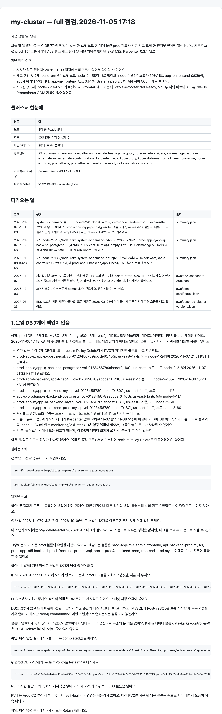
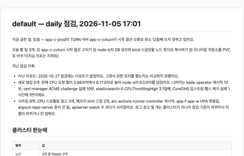

# kubegap

English: [README.md](README.md)

[](https://github.com/KyungHwanKim-devs/kubegap/actions/workflows/ci.yml) [](LICENSE)   

kubegap은 플랫폼이 다른 클러스터 세 개를 혼자 운영하면서 만들었습니다. 규모가 작은 k3s, EKS, 그리고 Azure 위의 Kubernetes입니다. 알림과 대시보드는 미리 정해 둔 것만 잡아 줍니다. 그 바깥의 문제는 클러스터를 직접 뒤져야 보이는데, 세 곳을 매일 그렇게 들여다볼 시간이 없었습니다. 그래서 그 일을 AI 에이전트에게 맡겼습니다.

Claude Code에서 `/kubegap`, Codex에서 `$kubegap`을 치면 에이전트가 클러스터 상태를 읽어 오고, 12개 영역 407개 점검 항목으로 따져 본 뒤, 지금 손봐야 할 문제를 골라 리포트를 씁니다. 문제마다 근거와 원인, 고치는 방법까지 적습니다. 한 EKS 클러스터에서는 스팟 회수로 백엔드가 2분 동안 멈췄는데 알림은 하나도 울리지 않은 일을 잡아냈습니다.

점검 항목 407개 중 112개에는 공개된 장애 사례와 포스트모템이 붙어 있습니다. 모두 207건이고, Airbnb나 Buffer의 사례도 있습니다. 항목별 링크는 [`docs/CHECKS.md`](docs/CHECKS.md)에서 볼 수 있습니다. 공개 사례가 없는 항목은 설정 규칙이고, 리포트는 사례를 지어내지 않고 없다고 씁니다. 리포트의 문제마다 붙는 "왜 이런 일이 생기나"에는 원리와 공개 사례, 더 읽을 공식 문서나 책을 적습니다. Kubernetes 공식 문서, AWS 문서, Google의 『Site Reliability Engineering』 같은 자료입니다. 실제 모습은 [EKS 샘플 리포트](samples/ko/eks/full/report.md)에서 볼 수 있습니다.

메트릭 이름, 로그 문구, API 필드처럼 kubegap이 다른 도구에 기대는 사실은 그 도구의 소스 코드를 버전별로 찾아 [`references/sources.md`](references/sources.md)에 출처를 적어 두었습니다. 그렇게 적어 둔 표가 1,500행이 넘습니다.

kubegap은 [Agent Skills](https://agentskills.io) 형식의 스킬입니다. 에이전트가 따라갈 절차와 그때 쓸 스크립트를 담은 폴더이고, 따로 띄워 둘 서버는 없습니다. 클러스터는 읽기만 하고 아무것도 바꾸지 않습니다. 모니터링이나 알림 도구가 아니고 문제를 고쳐 주지도 않습니다. 클러스터와 이미 깔아 둔 모니터링에 어떤 빈틈이 있는지 찾아 줍니다.


*실제 점검 화면입니다. 클러스터 정보는 마스킹했습니다.*

## 어떤 리포트를 받나

리포트는 첫 화면에서 지금 급한 일이 있는지, 오늘 할 일이 무엇인지, 지난 리포트가 시킨 일을 했는지를 보여 줍니다. 그다음 클러스터 한눈에(노드·파드·네임스페이스·컴포넌트·저장소)와 다가오는 일(노드·인증서 만료, 지원 종료, 정리 작업)이 오는데, 둘 다 코드가 수집 자료에서 만듭니다. 문제마다 여섯 가지를 적습니다. 지금 무슨 일이 일어나고 있고 누가 영향을 받는지(실제로 본 것만), 이유, 권하는 조치, 되돌리는 방법, 왜 이런 일이 생기는지, 그리고 근거와 출처 파일입니다. 문제들 뒤에는 지난 리포트가 시킨 일을 했는지 표, 그 밖의 critical·high 항목 전부 한 줄씩, full 점검이면 영역별 한 줄이 옵니다. 해결 단계마다 실행하면 클러스터에 무슨 일이 생기는지, 무엇이 재시작되거나 멈추는지, 끝났는지 어떻게 확인하는지를 적습니다. 리포트를 쓰기 전에 별도의 에이전트가 모든 단계를 클러스터 오브젝트와 대조해서 해가 될 수 있는 단계는 빼거나 조건을 붙입니다. 아래는 EKS 클러스터를 full로 점검한 샘플 리포트의 첫 번째 문제입니다. 클러스터 정보는 마스킹했고, 이미지를 누르면 리포트 전체를 볼 수 있습니다.

[](samples/ko/eks/full/report.md)

샘플 리포트는 [`samples/`](samples/README.md)에 있습니다. 한국어 샘플은 EKS의 full 점검과 소규모 k3s의 daily 점검 두 개이고, 영어 샘플은 EKS와 k3s의 daily, full 네 개입니다. 리포트 언어는 실행할 때 고릅니다.



### daily 점검과 full 점검

평소에는 daily를 돌리고, 클러스터를 제대로 한 번 훑어볼 때 full을 돌립니다.

| | daily 점검 | full 점검 |
|---|---|---|
| 명령 | `/kubegap` | `/kubegap full` |
| 언제 | 매일 | 클러스터를 넘겨받을 때, 업그레이드 전, 분기 리뷰, 장애 뒤 |
| 리포트의 문제 수 | 오늘 손댈 3개 | 5개 |
| 비교 대상 | 지난 daily 점검 | 지난 full 점검 |
| 읽는 것 | Kubernetes 오브젝트와 이벤트, 컴포넌트 로그, Prometheus와 Loki의 데이터. EKS에서는 AWS 자원 목록까지 | daily가 읽는 것에 노드 안쪽, 컨트롤플레인 로그, 추가 도구의 결과를 더합니다. EKS에서는 비용과 ECR까지 |

full에서만 모으는 항목은 daily 점검에서 문제로도 통과로도 세지 않고, 못 봤다고 적습니다.

점검이 끝나면 파일이 두 개 나옵니다. `report.md`는 사람이 읽는 리포트이고, `report-details.md`에는 판정 결과가 전부 표로 들어갑니다. full 점검의 `report-details.md`에는 12개 영역의 세부 내용도 있습니다.

점검 항목 407개 중 405개는 스크립트가 판정하기 때문에 같은 데이터로 돌리면 결과도 같습니다. 나머지 2개는 에이전트가 판정합니다. 에이전트는 결과를 읽고 무엇이 더 급한지 정해서 리포트를 쓰는데, 스크립트의 판정을 바꾼 곳이 있으면 이유와 함께 `report-details.md`에 남깁니다.

## 어떤 클러스터에서 쓸 수 있나

kubectl로 읽을 수 있는 클러스터라면 어디서든 돌아갑니다. 다만 볼 수 있는 깊이는 클러스터 종류마다 다릅니다.

| 클러스터 | 지금 볼 수 있는 곳 |
|---|---|
| EKS | 클러스터 안, 노드 안, AWS 쪽의 컨트롤플레인 로그, 노드 그룹, 애드온, 스팟, 비용 |
| k3s | 클러스터 안, 노드 안, k3s 로그, etcd, 데이터스토어 |
| GKE, AKS, kubeadm 등 | 클러스터 안, 노드 안 |

EKS와 k3s부터 만들어서 이 둘을 가장 깊이 봅니다. GKE와 AKS는 아직 전용 수집기가 없어서 클라우드 쪽을 못 보는데, 앞으로 볼 수 있는 범위를 늘려 가려고 합니다. 노드 안까지 보려면 접속을 허락해 줘야 하는데, 이 내용은 [처음 돌릴 때](#처음-돌릴-때)에 적었습니다.

## 설치하고 돌려 보기

준비할 것은 이렇습니다.

- **AI 에이전트.** Claude Code나 Codex면 됩니다. Cursor, GitHub Copilot처럼 Agent Skills 형식을 읽고 셸 명령을 실행하는 에이전트에서도 쓸 수 있습니다.
- **클러스터를 읽을 수 있는 kubectl.** 권한이 좁으면 읽지 못한 만큼 리포트에서 빠집니다.
- **python3 3.11 이상.** kubegap 스크립트가 Python으로 돌아서 이것만은 미리 깔아 두어야 합니다. macOS에 기본으로 들어 있는 python3는 버전이 더 낮을 수 있습니다.
- **jq.** 없으면 kubegap이 설치할지 묻습니다.
- **EKS라면 AWS CLI.** 이것도 없으면 설치할지 묻습니다. 없는 채로 돌리면 AWS 쪽은 읽지 못합니다.

macOS와 Linux에서 돌아가고, Windows에서는 WSL2 안에서 돌아갑니다.

Node.js 22.20 이상이 있으면 한 줄로 설치됩니다. `-g`를 빼면 지금 폴더에서만 쓸 수 있습니다.

```bash
npx skills add KyungHwanKim-devs/kubegap -g
```

Node.js가 없으면 저장소를 받아서 에이전트의 스킬 폴더에 심볼릭 링크를 만듭니다. 링크 이름은 `kubegap`이어야 합니다.

```bash
git clone https://github.com/KyungHwanKim-devs/kubegap ~/src/kubegap

# Claude Code
mkdir -p ~/.claude/skills && ln -s ~/src/kubegap ~/.claude/skills/kubegap

# Codex
mkdir -p ~/.agents/skills && ln -s ~/src/kubegap ~/.agents/skills/kubegap
```

그다음 에이전트를 열고 Claude Code에서는 `/kubegap`, Codex에서는 `$kubegap`을 치면 됩니다. 아래부터는 `/kubegap`으로만 적겠습니다. 점검하는 동안 에이전트가 명령을 실행해도 되는지 물을 수 있고, 점검이 끝나면 리포트 파일 두 개의 경로를 알려 줍니다.

## 처음 돌릴 때

설정 파일 없이도 돌아가지만, 처음부터 모든 것이 보이는 것은 아닙니다. 어디까지 보이는지는 클러스터와 로컬 환경에 무엇이 준비돼 있느냐에 달렸습니다.

실행할 때마다 먼저 두 가지를 묻습니다. 리포트를 영어로 받을지 한국어로 받을지, 그리고 kubectl이 지금 가리키는 클러스터를 점검할지입니다. 미리 정해 두는 방법은 [`docs/ko/SETUP.md`](docs/ko/SETUP.md)에 있습니다.

아무 설정이 없으면 Kubernetes API로 오브젝트, 이벤트, 컴포넌트 파드의 로그와 메트릭을 읽습니다. Prometheus, Alertmanager, Loki, Grafana는 클러스터 안에 Service가 있으면 찾아서 거기 쌓인 메트릭과 로그를 읽습니다. EKS에서는 kubeconfig에 적힌 프로파일로, 없으면 AWS CLI 기본 설정으로 AWS 쪽도 읽습니다. 권한이 없으면 그 호출로 판정하는 항목만 빠집니다.

더 보려면 정해 줘야 할 것이 네 가지 있습니다. 이 가운데 아직 준비되지 않은 것만 에이전트가 선택지를 띄워 물어봅니다. 무슨 일을 하는지와 리포트에 무엇이 늘어나는지가 같이 나오고, 전부 건너뛸 수 있습니다. 고르기 전에는 아무것도 설치하지 않고, 어디에도 올리지 않고, 노드에 접속하지도 않습니다.

- **추가 도구.** 알맞은 requests를 계산하는 krr, 지원이 끝난 API를 찾는 pluto, 매니페스트를 검사하는 polaris처럼 kubegap이 돌려서 결과를 읽는 도구입니다. EKS라면 AWS CLI도 여기서 묻습니다. 없는 도구와 그 도구가 맡은 항목을 보여 주고, 설치는 로컬에만 합니다. 도구마다 어디에 설치되고 없으면 리포트에 어떻게 적히는지는 [`docs/ko/SETUP.md`의 표](docs/ko/SETUP.md#추가-도구)에 있습니다.
- **노드 안쪽 점검.** 노드에 들어갈 방법이 아직 없을 때 묻습니다. 고르면 노드마다 들어가서 디스크, 커널 로그, 런타임 상태를 읽습니다. full 점검의 항목이 최대 26개 늘고, k3s에서는 k3s 로그와 etcd 스냅샷 항목도 늘어납니다.
- **Grafana 토큰.** Helm이 ConfigMap으로 넣은 대시보드와 데이터소스는 토큰 없이, 질문 없이 거기서 읽습니다. Grafana 자체 메트릭이 대시보드 전체 개수를 알려 주므로, Grafana에 그보다 많이 있을 때만, 즉 Grafana 화면에서 직접 만든 대시보드가 있을 때만 몇 개인지와 함께 이 질문이 나옵니다. 그때 읽기 전용 토큰 만드는 법을 알려 주고, 토큰을 설정 파일에 직접 넣어 두면 그 대시보드도 목록에 들어갑니다.
- **모니터링 도구 주소.** Prometheus, Alertmanager, Loki, Grafana의 Service가 클러스터에 없을 때 묻습니다. 클러스터 밖에 있으면 주소를 적으면 되고, 아예 안 깔았으면 없다고 고르면 됩니다. 로그 수집기 설정에 로그가 Elasticsearch나 CloudWatch Logs 같은 다른 곳으로 간다고 적혀 있으면 Loki는 묻지 않고, 리포트에 그렇게 적습니다.

건너뛰면 그만큼 리포트에서 빠질 뿐, 나머지 점검은 그대로 진행합니다. 못 본 것은 리포트의 "이번에 확인 못 한 것"에 적고 통과로 세지 않습니다. 건너뛴 질문은 클러스터별로 기억해 두고 다시 묻지 않지만, 새로 빠진 도구나 모니터링 도구가 생기면 그때 다시 묻습니다. 마음이 바뀌면 `/kubegap setup`으로 다시 고르면 됩니다.

설정 파일에 저장할 내용은 먼저 보여 주고, 확인을 받은 뒤에 저장합니다.

### 노드에는 어떻게 들어가나

노드 안쪽 항목은 full 점검에서 확인합니다. 들어가는 길은 클러스터 종류마다 다릅니다.

- **EKS.** AWS Systems Manager로 노드에서 읽기 명령을 root로 실행합니다. 실행할 수 있는 명령을 고정해 둔 SSM 문서 `kubegap-node-read`가 AWS 계정에 있어야 합니다. 올리겠다고 고르면 kubegap이 올리는데, 이때 쓰는 자격 증명에 SSM 문서를 올릴 권한이 필요합니다. 노드 역할에는 `AmazonSSMManagedInstanceCore`가 있어야 합니다.
- **k3s, RKE2, 직접 설치한 클러스터.** 로컬 SSH 설정에 있는 사용자와 키로 접속합니다. 노드의 호스트 키가 `known_hosts`에 있어야 하고, 일부 로그는 그 사용자에게 그룹이나 sudoers 설정이 있어야 읽힙니다. 응답하지 않는 노드가 있으면 이유를 알려 주고, 호스트 키를 받을지, 주소를 직접 적을지, 응답하는 노드만으로 갈지 고르게 합니다.
- **GKE, AKS처럼 SSM도 SSH도 없는 플랫폼.** 노드 안쪽은 읽지 않습니다. 노드 점검 항목은 미수집으로 적히고, Kubernetes API와 Prometheus, node-exporter에서 오는 것은 그대로 점검합니다.

이미 준비돼 있으면 묻지 않고 노드 안쪽까지 봅니다. EKS 계정에 SSM 문서가 있거나, 설정 파일에 `ssh:`나 `node_access: ssh`가 있는 경우입니다. SSH는 접속이 되는 환경이어도 직접 고르기 전에는 쓰지 않습니다. 노드 접속이 정해져 있으면 daily 점검도 Prometheus가 수집하지 않는 컴포넌트의 메트릭을 노드에서 읽을 수 있습니다.

## 명령

```
/kubegap                                      # daily 점검
/kubegap full                                 # full 점검
/kubegap full focus <영역>                    # 전부 모으고, 분석과 리포트는 한 영역만
/kubegap explain <항목 id> --snapshot latest  # 지난 점검의 항목 하나를 원본 데이터까지 따라가며 설명
/kubegap --compare <A> <B>                    # 새로 점검하고, 지난 점검 A와 B의 비교를 리포트에 넣기
/kubegap --context <이름>                     # kubeconfig의 다른 컨텍스트 점검
/kubegap setup                                # 처음에 묻던 것을 다시 고르기
```

`focus`의 영역 이름은 아래 표에 있습니다. daily 점검에 `focus`를 붙이면 full에서만 모으는 항목은 빠집니다.

`explain`은 새로 모으지 않습니다. `--snapshot latest`가 가장 최근에 모은 데이터를 쓰라는 뜻입니다. 항목 id는 리포트 맨 아래 "문제별 체크"에 문제마다 적혀 있고, 문제 하나에 여러 개가 있습니다.

`--compare`의 A와 B에는 `2026-11-05T08-30-12` 같은 폴더 이름을 넣습니다. 점검할 때마다 `~/.kubegap/snapshots/<컨텍스트 이름>/` 아래에 이런 폴더가 하나씩 생깁니다. 컨텍스트 이름의 특수 문자는 `_`로 바뀝니다. 날짜만 적어도 되지만, 그러면 그날의 마지막 점검을 daily, full 가리지 않고 고릅니다. daily는 daily끼리, full은 full끼리 비교되도록 폴더 이름을 적어 주세요.

## 무엇을 점검하나

12개 영역에 점검 항목 407개가 있습니다. 항목 하나가 "이 상태면 문제다"라는 기준 하나입니다. 전체 목록은 [`docs/CHECKS.md`](docs/CHECKS.md)에 있고, 공개된 사고 사례가 있는 항목은 거기에 링크를 달아 두었습니다.

| 영역 | `focus` 이름 | 항목 수 | 예시 |
|---|---|---|---|
| 리소스 | `resources` | 15 | requests가 7일 p95 사용량의 3배가 넘는 컨테이너, 반복되는 OOMKilled, requests는 꽉 찼는데 사용률은 한 자릿수인 노드 |
| 스케일링 | `scaling` | 27 | 15일 내내 최소값에 머문 HPA, 만료됐는데 교체되지 않는 Karpenter 노드, fallback 없는 KEDA 외부 트리거 |
| 관측성 | `observability` | 64 | 증상 기반 알림 없음, 7일 내내 울리는 알림, emptyDir 위의 관측 스택, 수집되지 않는 인그레스 컨트롤러 메트릭 |
| 트래픽 | `traffic` | 57 | 인터넷에 열린 DB 포트, 비정상 ALB 타깃, 종료 유예보다 긴 deregistration delay |
| 복원력 | `resilience` | 43 | 한 노드에 몰린 레플리카, PDB 없음, 원본과 같은 디스크에 있는 백업 덤프, 노드 하나에만 갈 수 있는 워크로드 |
| 위생 | `hygiene` | 35 | `latest` 태그, 지원이 끝난 API, pending이나 failed로 남은 Helm 릴리스, 직접 붙인 노드 레이블 의존 |
| 스토리지 | `storage` | 25 | 암호화되지 않은 EBS, 확장이 꺼진 StorageClass, 용량을 넘긴 local-path 볼륨 |
| 보안 | `security` | 46 | 적용되지 않는 NetworkPolicy, IMDSv1 허용, 환경 변수에 평문으로 넣은 비밀값, 와일드카드 RBAC |
| 비용 | `cost` | 13 | 유휴 컴퓨트 비율, requests를 과하게 잡아서 나가는 월 비용, 수명 주기 정책 없는 ECR 저장소 |
| 멀티테넌시 | `tenancy` | 13 | 쿼터, NetworkPolicy, PSA가 없는 prod 네임스페이스, 같은 노드를 쓰는 CI와 prod |
| 노드 OS | `node` | 37 | 디스크와 inode, 커널 OOM과 NIC 오류, kubelet 예약 없음, cgroup v1, 3 GiB가 넘는 이미지 |
| 플랫폼 | `platform` | 32 | Kubernetes 지원 종료, 오래된 애드온, AMI 나이, 한도에 가까운 서비스 쿼터, 느린 k3s etcd, 시크릿 암호화 꺼짐 |

노드 OS 37개 중 26개는 노드에 들어가야 볼 수 있습니다.

407개가 모든 클러스터에 다 적용되지는 않습니다. Karpenter, Argo CD, cert-manager 같은 컴포넌트의 항목은 그 컴포넌트가 설치돼 있을 때만 점검합니다. daily 점검은 full 전용 81개를 뺀 최대 326개를 봅니다.

기준은 클러스터 종류와 크기를 보고 정합니다. EKS에는 운영 환경 기준을 적용합니다. k3s, RKE2, 3노드 이하 클러스터에는 소규모 기준을 적용해서 백업, SLO, 알림 라우터는 요구하지만 멀티 존 분산이나 PDB는 요구하지 않습니다. `--profile`로 바꿀 수 있습니다.

## 클러스터와 데이터를 어떻게 다루나

kubegap은 클러스터를 읽기만 합니다. Pod, Deployment, 이벤트, 로그, 메트릭을 읽어 올 뿐 아무것도 만들거나 바꾸거나 지우지 않습니다. Prometheus나 Grafana는 포트포워드로 읽는데, 이것도 클러스터에 아무것도 남기지 않습니다.

접속에는 지금 쓰고 있는 kubeconfig, AWS CLI 프로파일, SSH 설정을 그대로 씁니다. 클러스터에 따로 깔아 두는 것도 없습니다.

Secret 값은 모으지 않고 이름과 종류만 봅니다. full 점검에서 쓰는 `helm list`는 Helm이 Secret에 넣어 둔 릴리스 기록을 읽지만, kubegap은 릴리스 이름과 상태, 버전 같은 정보만 남기고 values는 수집하지 않습니다. pluto는 클러스터에 접속하지 않고, kubegap이 Secret 없이 저장해 둔 오브젝트를 검사합니다.

ConfigMap 값도 저장하지 않습니다. 키마다 길이와 형태만 남기고, 실제 값은 CoreDNS Corefile이나 kube-proxy 설정처럼 kubegap이 분석해야 하는 키만 남깁니다.

컴포넌트 파드 로그는 스크립트가 읽어서 오류 유형별로 세고, 마스킹한 샘플만 남긴 뒤 원본은 지웁니다. 에이전트가 리포트를 쓰기 전에 지우기 때문에 에이전트는 원본 로그를 보지 않습니다.

노드에서는 정해 둔 읽기 명령만 실행합니다. 어떤 명령을 실행하는지는 [`deploy/node-access/COMMANDS.md`](deploy/node-access/COMMANDS.md)에 전부 공개해 두었습니다.

수집한 데이터는 내 컴퓨터의 `~/.kubegap/`에 점검할 때마다 폴더로 쌓입니다. full 한 번에 40 MB쯤 되고, 오래된 것은 `scripts/kubegap prune`으로 지우면 됩니다.

필요한 권한은 하나하나 [`docs/ko/PERMISSIONS.md`](docs/ko/PERMISSIONS.md)에, 수집하는 데이터는 [`docs/ko/DATA.md`](docs/ko/DATA.md)에 정리해 두었습니다. 보안 검토에 쓸 ClusterRole과 IAM 정책은 [`deploy/permissions/`](deploy/permissions/)에 있습니다.

## 문서

- [`docs/ko/SETUP.md`](docs/ko/SETUP.md): 클러스터와 AWS, 노드에 어떻게 연결하는지, 설정을 바꾸는 법, 가장 좁은 권한으로 돌리는 법
- [`docs/ko/PERMISSIONS.md`](docs/ko/PERMISSIONS.md): 권한 하나하나의 쓰임과 그 권한이 없을 때 빠지는 것
- [`docs/ko/DATA.md`](docs/ko/DATA.md): 무엇을 모으고, 남기고, 모델로 보내는지
- [`docs/ko/HEADLESS.md`](docs/ko/HEADLESS.md): 사람 없이 돌리는 법, 매일 아침 예약해서 돌리는 법
- [`docs/CHECKS.md`](docs/CHECKS.md): 점검 항목 전체, 영어
- [`docs/DESIGN-DECISIONS.md`](docs/DESIGN-DECISIONS.md): 왜 이렇게 만들었는지, 영어
- [`CONTRIBUTING.md`](CONTRIBUTING.md), [`references/development.md`](references/development.md): 점검 항목을 추가하거나 고치는 법, 영어

## 라이선스

MIT 라이선스입니다. 자세한 내용은 [LICENSE](LICENSE) 파일에 있습니다.
