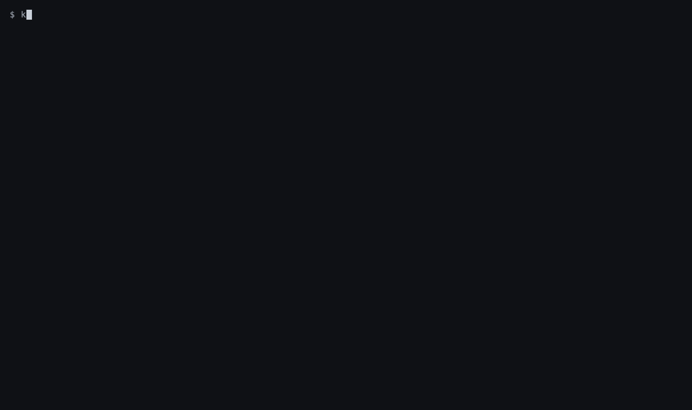
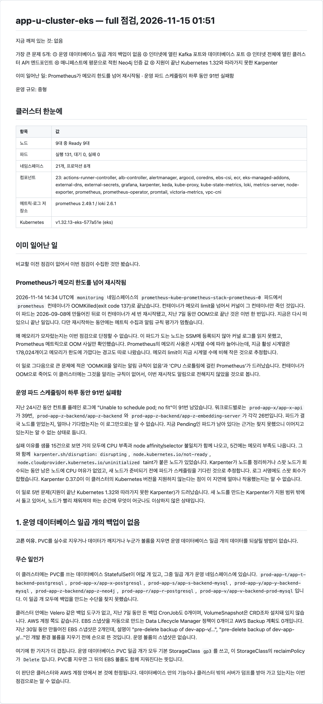

# kubegap

English: [README.md](README.md)

[](https://github.com/KyungHwanKim-devs/kubegap/actions/workflows/ci.yml) [](LICENSE)   

kubegap은 Kubernetes 클러스터를 읽기 전용으로 점검하고, 지금 손봐야 할 문제를 근거와 함께 리포트로 써 주는 AI 에이전트용 스킬입니다. Claude Code나 Codex 같은 에이전트 안에서 명령 한 줄로 돌립니다.

```
/kubegap          # daily 점검: 3~5분, 한두 화면짜리 리포트
/kubegap full     # full 점검: 클러스터 전체를 깊이 읽고 쓰는 긴 리포트
```

- **무엇을 찾나.** 알림과 대시보드는 미리 정해 둔 것만 잡습니다. kubegap은 그 바깥을 봅니다. 백업이 클러스터 밖에 없다, 알림이 아무에게도 전달되지 않고 있다, 레플리카가 전부 한 노드에 있다, Kubernetes 버전의 지원이 끝났다 같은 것들입니다. 12개 영역에 점검 항목 411개가 있습니다.
- **무엇을 받나.** 마크다운 리포트입니다. 지금 깨져 있는 것, 그동안 일어난 일, 가장 중요한 문제 몇 개를 고르고, 문제마다 무슨 일인지, 왜 중요한지, 무엇을 하면 되는지를 이 클러스터의 이름과 숫자로 적습니다.
- **무엇을 하지 않나.** 클러스터를 바꾸지 않습니다. 읽기만 합니다. 서버를 띄우지 않고 클러스터에 아무것도 설치하지 않습니다. 모니터링 도구나 알림 도구가 아니고, 문제를 대신 고쳐 주지도 않습니다.



*판정하고 결과를 읽는 단계입니다. 화면의 스냅샷은 저장소에 들어 있는 시험용이고 이름은 전부 바꾼 것입니다.*

## 어떻게 동작하나

kubegap은 [Agent Skills](https://agentskills.io) 형식의 스킬입니다. 에이전트가 따라갈 절차(`SKILL.md`)와 그 절차가 부르는 파이썬 스크립트가 들어 있는 폴더입니다. 명령을 치면 아래 네 단계가 차례로 돕니다.

| 단계 | 누가 | 무엇을 하나 |
|---|---|---|
| 1. 수집 | 스크립트 | `kubectl`로 오브젝트와 이벤트를 읽고, 클러스터 안의 Prometheus, Alertmanager, Grafana, Loki에 질의합니다. full 점검은 노드 안쪽과 클라우드 계정(EKS의 AWS)까지 읽습니다. 읽은 것은 내 컴퓨터의 폴더 하나(스냅샷)에 저장합니다. |
| 2. 판정 | 스크립트 | 스냅샷을 점검 항목 411개에 대 봅니다. 항목 하나는 "이 상태면 문제다"라는 규칙 하나입니다. 스크립트가 판정하므로 같은 스냅샷이면 결과가 같습니다. |
| 3. 분석 | 에이전트 | 판정 결과를 읽고, 필요하면 스냅샷의 원본을 열어 판정이 맞는지 확인하고, 원인이 같은 것을 묶고, 무엇이 더 중요한지 고릅니다. |
| 4. 리포트 | 에이전트와 스크립트 | 에이전트가 문제를 설명하는 글을 쓰고, 스크립트가 그 글의 숫자와 주소와 형식을 검사한 뒤 리포트 파일로 조립합니다. 검사에 걸리면 리포트는 만들어지지 않습니다. |

에이전트가 클러스터에 직접 명령을 보내는 단계는 없습니다. 클러스터에 닿는 것은 1단계의 스크립트뿐이고, 그 스크립트가 실행하는 것은 읽기 명령뿐입니다. 에이전트의 모델에 전달되는 것은 스냅샷에 저장된 것뿐이며, Secret 값은 어느 점검에서도 읽지 않습니다. 무엇이 저장되는지는 [클러스터와 데이터를 어떻게 다루나](#클러스터와-데이터를-어떻게-다루나)에 있습니다.

## daily 점검과 full 점검

| | daily 점검 | full 점검 |
|---|---|---|
| 명령 | `/kubegap` | `/kubegap full` |
| 걸리는 시간 | 3~5분 (노드 2대 k3s에서 2분 30초, 노드 9대 EKS에서 4분) | 15분 안팎 (같은 두 클러스터에서 14분, 15분). 노드 안쪽까지 읽으면 더 걸립니다 |
| 언제 | 매일 | 클러스터를 넘겨받을 때, 업그레이드 전, 분기 리뷰, 장애 뒤 |
| 리포트 | 한두 화면. 지금 깨져 있는 것, 지난 점검 이후 일어난 일, 가장 중요한 것 세 개 | 긴 리포트. 가장 큰 문제 다섯 개까지를 문제마다 원리, 점검 방법, 규모별 해결 방안, 근거까지 설명 |
| 읽는 것 | Kubernetes 오브젝트와 이벤트, 메트릭, 플랫폼 구성 요소 로그의 패턴별 개수 | daily가 읽는 것에 더해 노드 안쪽, 컨트롤 플레인 로그, 클라우드 계정, 애플리케이션 설정, 추가 도구의 결과 |
| 읽지 않는 것 | 노드, AWS API, 애플리케이션의 command·args·환경 변수 값·ConfigMap 키, 로그 문장 | Secret 값 |
| 비교 대상 | 지난 daily 점검 | 지난 full 점검 |

daily는 세 가지 이유로 따로 있습니다. full은 오래 걸립니다. full은 클러스터를 깊이 읽어서, 그 내용이 내 컴퓨터에 남고 모델에 전달되는 것이 부담스러울 수 있습니다. full 리포트는 정보의 종류가 많아서 지금 무엇이 중요한지 한눈에 보이지 않습니다. 그래서 daily는 덜 읽고, 덜 남기고, 짧게 씁니다.

daily가 읽지 않아서 판단하지 못한 것은 문제로도 통과로도 세지 않습니다. 리포트 끝의 "이번 점검이 보지 않은 것"에 무엇을 읽지 않았고 그래서 무엇을 알 수 없는지를 적습니다. 모드마다 정확히 무엇을 읽는지는 [`collectors/units.yaml`](collectors/units.yaml) 한 파일에 선언되어 있고, 수집 코드와 리포트의 그 절이 모두 이 파일을 따릅니다.

## 어떤 리포트를 받나

**daily 리포트**는 이런 순서입니다.

1. 첫 화면: 지금 깨져 있는 것, 지난 점검 이후 일어난 일, 가장 중요한 것 세 개의 제목
2. 클러스터 한눈에: 노드, 파드, 네임스페이스, 구성 요소, 버전
3. 지금 깨져 있는 것과 일어난 일: 무엇이 언제 몇 번, 지금도 이어지는지
4. 가장 중요한 것 세 개: 각각 무슨 일인가, 왜 중요한가, 무엇을 하면 되나, 더 읽기
5. 그 밖에 열려 있는 것, 지난 점검과 달라진 것
6. 이번 점검이 보지 않은 것

**full 리포트**는 가장 큰 문제 다섯 개까지를 문제마다 여섯 절로 설명합니다. 무슨 일인가, 왜 생기나, 추천 점검 방법, 추천 해결 방안(운영 규모별), 근거, 더 읽을 것입니다. 그 앞뒤로 지금 깨져 있는 것, 이미 일어난 일, 그다음으로 큰 문제, 지난 리포트 이후 달라진 것, 다가오는 일(인증서 만료, 지원 종료), 영역별 한 줄, 이번 점검의 한계가 옵니다. 따라 치는 명령 목록이 아니라 진단과 설명입니다. 판정 결과 전체는 `report-details.md`에 표로 따로 나옵니다.

두 리포트 모두 글에 쓴 숫자는 스냅샷의 값과 맞아야 하고, 주소는 누군가 열어 읽은 문서의 것이어야 조립됩니다. 공개된 장애 사례가 있는 점검 항목에는 그 사례가 붙습니다([`docs/CHECKS.md`](docs/CHECKS.md)).

아래는 EKS 클러스터를 full로 점검한 샘플 리포트의 앞부분입니다. 그림을 누르면 리포트 전체가 열립니다.

[](samples/ko/eks/full/report.md)

daily 리포트는 이만큼입니다. k3s 샘플을 위에서 아래로 넘긴 모습입니다.

[](samples/ko/k3s/daily/report.md)

실제 클러스터에서 나온 리포트에서 이름만 바꾼 샘플이 [`samples/`](samples/README.md)에 있습니다. 리포트 언어(한국어, 영어)는 실행할 때 고릅니다.

## 설치하고 돌려 보기

준비할 것은 이렇습니다.

- **AI 에이전트.** Claude Code나 Codex면 됩니다. Cursor, GitHub Copilot처럼 Agent Skills 형식을 읽고 셸 명령을 실행하는 에이전트에서도 쓸 수 있습니다.
- **클러스터를 읽을 수 있는 kubectl.** 권한이 좁으면 읽지 못한 만큼 리포트에서 빠집니다.
- **python3 3.11 이상.** kubegap 스크립트가 Python으로 돌아서 이것만은 미리 깔아 두어야 합니다. macOS에 기본으로 들어 있는 python3는 버전이 더 낮을 수 있습니다.
- **jq.** 없으면 kubegap이 설치할지 묻습니다.
- **EKS라면 AWS CLI.** 이것도 없으면 설치할지 묻습니다. 없는 채로 돌리면 AWS 쪽은 읽지 못합니다.

macOS와 Linux에서 돌아가고, Windows에서는 WSL2 안에서 돌아갑니다.

Node.js 22.20 이상이 있으면 한 줄로 설치됩니다. `-g`를 빼면 지금 폴더에서만 쓸 수 있습니다.

```bash
npx skills add KyungHwanKim-devs/kubegap -g
```

Node.js가 없으면 저장소를 받아서 에이전트의 스킬 폴더에 심볼릭 링크를 만듭니다. 링크 이름은 `kubegap`이어야 합니다.

```bash
git clone https://github.com/KyungHwanKim-devs/kubegap ~/src/kubegap

# Claude Code
mkdir -p ~/.claude/skills && ln -s ~/src/kubegap ~/.claude/skills/kubegap

# Codex
mkdir -p ~/.agents/skills && ln -s ~/src/kubegap ~/.agents/skills/kubegap
```

그다음 에이전트를 열고 Claude Code에서는 `/kubegap`, Codex에서는 `$kubegap`을 치면 됩니다. 아래부터는 `/kubegap`으로만 적겠습니다. 점검하는 동안 에이전트가 명령을 실행해도 되는지 물을 수 있고, 점검이 끝나면 리포트 파일의 경로를 알려 줍니다.

## 처음 돌릴 때

설정 파일 없이도 돌아가지만, 처음부터 모든 것이 보이는 것은 아닙니다. 어디까지 보이는지는 클러스터와 로컬 환경에 무엇이 준비돼 있느냐에 달렸습니다.

실행할 때마다 먼저 두 가지를 묻습니다. 리포트를 영어로 받을지 한국어로 받을지, 그리고 kubectl이 지금 가리키는 클러스터를 점검할지입니다. 미리 정해 두는 방법은 [`docs/ko/SETUP.md`](docs/ko/SETUP.md)에 있습니다.

daily 점검은 그 밖에 두 가지만 묻습니다. 이 클러스터를 어떤 규모로 운영하는지(문제의 심각도가 여기에 따라 달라집니다), 그리고 스냅샷을 둘 폴더를 다른 사용자가 읽을 수 있게 되어 있으면 그것을 고칠지입니다. 아무 설정이 없어도 Kubernetes API로 오브젝트와 이벤트를 읽고, Prometheus, Alertmanager, Loki, Grafana는 클러스터 안에 Service가 있으면 찾아서 읽습니다.

full 점검은 더 깊이 읽으므로 정해 줘야 할 것이 네 가지 더 있습니다. EKS에서는 kubeconfig에 적힌 프로파일로, 없으면 AWS CLI 기본 설정으로 AWS 쪽을 읽고, 권한이 없으면 그 호출로 판정하는 항목만 빠집니다. 네 가지 가운데 아직 준비되지 않은 것만 에이전트가 선택지를 띄워 물어봅니다. 무슨 일을 하는지와 리포트에 무엇이 늘어나는지가 같이 나오고, 전부 건너뛸 수 있습니다. 고르기 전에는 아무것도 설치하지 않고, 어디에도 올리지 않고, 노드에 접속하지도 않습니다.

- **추가 도구.** 알맞은 requests를 계산하는 krr, 지원이 끝난 API를 찾는 pluto, 매니페스트를 검사하는 polaris처럼 kubegap이 돌려서 결과를 읽는 도구입니다. EKS라면 AWS CLI도 여기서 묻습니다. 없는 도구와 그 도구가 맡은 항목을 보여 주고, 설치는 로컬에만 합니다. 도구마다 어디에 설치되고 없으면 리포트에 어떻게 적히는지는 [`docs/ko/SETUP.md`의 표](docs/ko/SETUP.md#추가-도구)에 있습니다.
- **노드 안쪽 점검.** 노드에 들어갈 방법이 아직 없을 때 묻습니다. 고르면 노드마다 들어가서 디스크, 커널 로그, 런타임 상태를 읽습니다. full 점검의 항목이 최대 26개 늘고, k3s에서는 k3s 로그와 etcd 스냅샷 항목도 늘어납니다.
- **Grafana 토큰.** Helm이 ConfigMap으로 넣은 대시보드와 데이터소스는 토큰 없이, 질문 없이 거기서 읽습니다. Grafana 자체 메트릭이 대시보드 전체 개수를 알려 주므로, Grafana에 그보다 많이 있을 때만, 즉 Grafana 화면에서 직접 만든 대시보드가 있을 때만 몇 개인지와 함께 이 질문이 나옵니다. 그때 읽기 전용 토큰 만드는 법을 알려 주고, 토큰을 설정 파일에 직접 넣어 두면 그 대시보드도 목록에 들어갑니다.
- **모니터링 도구 주소.** Prometheus, Alertmanager, Loki, Grafana의 Service가 클러스터에 없을 때 묻습니다. 클러스터 밖에 있으면 주소를 적으면 되고, 아예 안 깔았으면 없다고 고르면 됩니다. 로그 수집기 설정에 로그가 Elasticsearch나 CloudWatch Logs 같은 다른 곳으로 간다고 적혀 있으면 Loki는 묻지 않고, 리포트에 그렇게 적습니다.

건너뛰면 그만큼 리포트에서 빠질 뿐, 나머지 점검은 그대로 진행합니다. 못 본 것은 리포트의 "이번 점검의 한계"에 적고 통과로 세지 않습니다. 건너뛴 질문은 클러스터별로 기억해 두고 다시 묻지 않지만, 새로 빠진 도구나 모니터링 도구가 생기면 그때 다시 묻습니다. 마음이 바뀌면 `/kubegap setup`으로 다시 고르면 됩니다.

설정 파일에 저장할 내용은 먼저 보여 주고, 확인을 받은 뒤에 저장합니다.

### 노드에는 어떻게 들어가나

노드 안쪽 항목은 full 점검에서 확인합니다. 들어가는 길은 클러스터 종류마다 다릅니다.

- **EKS.** AWS Systems Manager로 노드에서 읽기 명령을 root로 실행합니다. 실행할 수 있는 명령을 고정해 둔 SSM 문서 `kubegap-node-read`가 AWS 계정에 있어야 합니다. 올리겠다고 고르면 kubegap이 올리는데, 이때 쓰는 자격 증명에 SSM 문서를 올릴 권한이 필요합니다. 노드 역할에는 `AmazonSSMManagedInstanceCore`가 있어야 합니다.
- **k3s, RKE2, 직접 설치한 클러스터.** 로컬 SSH 설정에 있는 사용자와 키로 접속합니다. 노드의 호스트 키가 `known_hosts`에 있어야 하고, 일부 로그는 그 사용자에게 그룹이나 sudoers 설정이 있어야 읽힙니다. 응답하지 않는 노드가 있으면 이유를 알려 주고, 호스트 키를 받을지, 주소를 직접 적을지, 응답하는 노드만으로 갈지 고르게 합니다.
- **GKE, AKS처럼 SSM도 SSH도 없는 플랫폼.** 노드 안쪽은 읽지 않습니다. 노드 점검 항목은 미수집으로 적히고, Kubernetes API와 Prometheus, node-exporter에서 오는 것은 그대로 점검합니다.

이미 준비돼 있으면 묻지 않고 노드 안쪽까지 봅니다. EKS 계정에 SSM 문서가 있거나, 설정 파일에 `ssh:`나 `node_access: ssh`가 있는 경우입니다. SSH는 접속이 되는 환경이어도 직접 고르기 전에는 쓰지 않습니다. daily 점검은 준비돼 있어도 노드에 접속하지 않습니다.

## 명령

```
/kubegap                                      # daily 점검
/kubegap full                                 # full 점검
/kubegap full focus <영역>                    # 전부 모으고, 분석과 리포트는 한 영역만
/kubegap explain <항목 id> --snapshot latest  # 지난 점검의 항목 하나를 원본 데이터까지 따라가며 설명
/kubegap --compare <A> <B>                    # 새로 점검하고, 지난 점검 A와 B의 비교를 리포트에 넣기
/kubegap --context <이름>                     # kubeconfig의 다른 컨텍스트 점검
/kubegap setup                                # 처음에 묻던 것을 다시 고르기
```

`focus`의 영역 이름은 아래 표에 있습니다. daily 점검에 `focus`를 붙이면 daily가 읽지 않는 자료가 필요한 항목은 빠집니다.

`explain`은 새로 모으지 않습니다. `--snapshot latest`가 가장 최근에 모은 데이터를 쓰라는 뜻입니다. 항목 id는 리포트 맨 아래 "문제별 체크"에 문제마다 적혀 있고, 문제 하나에 여러 개가 있습니다.

`--compare`의 A와 B에는 `2026-11-05T08-30-12` 같은 폴더 이름을 넣습니다. 점검할 때마다 `~/.kubegap/snapshots/<컨텍스트 이름>/` 아래에 이런 폴더가 하나씩 생깁니다. 컨텍스트 이름의 특수 문자는 `_`로 바뀝니다. 날짜만 적어도 되지만, 그러면 그날의 마지막 점검을 daily, full 가리지 않고 고릅니다. daily는 daily끼리, full은 full끼리 비교되도록 폴더 이름을 적어 주세요.

## 무엇을 점검하나

12개 영역에 점검 항목 411개가 있습니다. 항목 하나가 "이 상태면 문제다"라는 기준 하나입니다. 전체 목록은 [`docs/CHECKS.md`](docs/CHECKS.md)에 있고, 공개된 사고 사례가 있는 항목은 거기에 링크를 달아 두었습니다.

| 영역 | `focus` 이름 | 항목 수 | 예시 |
|---|---|---|---|
| 리소스 | `resources` | 15 | requests가 7일 p95 사용량의 3배가 넘는 컨테이너, 반복되는 OOMKilled, requests는 꽉 찼는데 사용률은 한 자릿수인 노드 |
| 스케일링 | `scaling` | 27 | 15일 내내 최소값에 머문 HPA, 만료됐는데 교체되지 않는 Karpenter 노드, fallback 없는 KEDA 외부 트리거 |
| 관측성 | `observability` | 64 | 증상 기반 알림 없음, 7일 내내 울리는 알림, emptyDir 위의 관측 스택, 수집되지 않는 인그레스 컨트롤러 메트릭 |
| 트래픽 | `traffic` | 61 | 인터넷에 열린 DB 포트, 비정상 ALB 타깃, 종료 유예보다 긴 deregistration delay |
| 복원력 | `resilience` | 43 | 한 노드에 몰린 레플리카, PDB 없음, 원본과 같은 디스크에 있는 백업 덤프, 노드 하나에만 갈 수 있는 워크로드 |
| 위생 | `hygiene` | 35 | `latest` 태그, 지원이 끝난 API, pending이나 failed로 남은 Helm 릴리스, 직접 붙인 노드 레이블 의존 |
| 스토리지 | `storage` | 25 | 암호화되지 않은 EBS, 확장이 꺼진 StorageClass, 용량을 넘긴 local-path 볼륨 |
| 보안 | `security` | 46 | 적용되지 않는 NetworkPolicy, IMDSv1 허용, 환경 변수에 평문으로 넣은 비밀값, 와일드카드 RBAC |
| 비용 | `cost` | 13 | 유휴 컴퓨트 비율, requests를 과하게 잡아서 나가는 월 비용, 수명 주기 정책 없는 ECR 저장소 |
| 멀티테넌시 | `tenancy` | 13 | 쿼터, NetworkPolicy, PSA가 없는 prod 네임스페이스, 같은 노드를 쓰는 CI와 prod |
| 노드 OS | `node` | 37 | 디스크와 inode, 커널 OOM과 NIC 오류, kubelet 예약 없음, cgroup v1, 3 GiB가 넘는 이미지 |
| 플랫폼 | `platform` | 32 | Kubernetes 지원 종료, 오래된 애드온, AMI 나이, 한도에 가까운 서비스 쿼터, 느린 k3s etcd, 시크릿 암호화 꺼짐 |

노드 OS 37개 중 26개는 노드에 들어가야 볼 수 있습니다.

411개가 모든 클러스터에 다 적용되지는 않습니다. Karpenter, Argo CD, cert-manager 같은 컴포넌트의 항목은 그 컴포넌트가 설치돼 있을 때만 점검합니다. daily 점검은 노드 안쪽이나 클라우드 계정처럼 daily가 읽지 않는 자료가 필요한 111개를 뺀 최대 300개를 봅니다.

기준은 클러스터를 어떤 규모로 운영하는지에 따라 달라집니다. kubegap은 클러스터마다 한 번 묻습니다. 소형(전담 SRE/DevOps 엔지니어 없음), 중형(운영 담당자가 있고 실제 사용자가 씀), 대형(전담 팀이 있고 장애가 매출이나 SLA에 바로 영향) 중에서 고릅니다. 이 답이 문제마다 심각도를 정합니다. SLO가 없는 것은 소형에서는 low, 대형에서는 critical이고, 백업이 없는 것은 어느 규모에서나 심각합니다. 답이 없으면 노드 수로 짐작하고 리포트에 그렇게 적습니다. 플랫폼(EKS, k3s, 그 밖)은 감지하며, 어떤 점검 항목을 돌릴 수 있는지만 정합니다.

## 어떤 클러스터에서 쓸 수 있나

kubectl로 읽을 수 있는 클러스터라면 어디서든 돌아갑니다. 다만 볼 수 있는 깊이는 클러스터 종류마다 다릅니다.

| 클러스터 | 지금 볼 수 있는 곳 |
|---|---|
| EKS | 클러스터 안, 노드 안, AWS 쪽의 컨트롤플레인 로그, 노드 그룹, 애드온, 스팟, 비용 |
| k3s | 클러스터 안, 노드 안, k3s 로그, etcd, 데이터스토어 |
| GKE, AKS, kubeadm 등 | 클러스터 안, 노드 안 |

EKS와 k3s부터 만들어서 이 둘을 가장 깊이 봅니다. GKE와 AKS는 아직 전용 수집기가 없어서 클라우드 쪽을 못 보는데, 앞으로 볼 수 있는 범위를 늘려 가려고 합니다. 노드 안까지 보려면 접속을 허락해 줘야 하는데, 이 내용은 [처음 돌릴 때](#처음-돌릴-때)에 적었습니다.

### 검증한 버전

kubegap 이 기대는 사실은 아래 구성 요소의 소스를 아래 버전에서 읽은 것입니다. 기준 클러스터 둘은 유지보수자가 운영하는 것입니다. 범위 밖이어도 kubegap 은 돌고, 리포트 머리가 그렇다고 말합니다. 마지막 열의 설명은 영문 그대로입니다(코드 안의 가정을 옮긴 문장입니다). `references/verified-versions.yaml` 에서 `scripts/kubegap verified --markdown --language ko` 로 생성하며, 인용 전체는 `references/sources.md` 에 있습니다.

<!-- verified-table:begin -->
| 구성 요소 | 소스로 읽은 버전 | 기준 클러스터 (EKS / k3s) | 가정한 설치 방식과 그 밖에서 일어나는 일 (영문) |
|---|---|---|---|
| Kubernetes (kube-apiserver, kubelet, kube-proxy, kube-scheduler, controller-manager) | v1.30.14 ~ v1.37.2 | v1.32.13 (EKS 1.32) / v1.33.5 (v1.33.5+k3s1) | the apiserver series are read under the job label kube-prometheus-stack gives them (`apiserver`), else a detected one — an older minor is read as is; a metric name that moved is caught by the series-presence record and the check skips naming it; the apiserver job comes from config key `apiserver_job` when detection fails |
| k3s (the embedded apiserver, kubelet, kube-proxy, flannel, kine, etcd) | v1.33.5+k3s1 ~ v1.37.2+k3s1 | — / v1.33.5+k3s1 | node access over SSH; the k3s-platform collector runs when the platform is k3s or rke2 — a cluster that is not k3s skips every `platform.k3s-*` check |
| containerd | v1.7.27 ~ v2.4.2 | v1.7.29, v2.1.5 (the two node images) / v2.1.4-k3s1 | the log signatures match the texts read at these versions; another runtime writes nothing they know |
| CoreDNS | v1.10.1 ~ v1.15.0 | v1.11.3 / v1.12.3 | scraped by Prometheus (`coredns_*` series) — the forward metrics moved to `coredns_proxy_*` at 1.11.0 and the queries read both spellings |
| metrics-server | v0.8.0 ~ v0.9.1 | v0.8.0 / v0.8.0 | — |
| node-exporter | v1.7.0 ~ v1.12.1 | v1.7.0 / v1.10.2 | scraped by Prometheus with the host network (the node checks join on `instance`) — a collector that is off by default (processes) is not read; the series-presence record makes the check skip |
| kube-state-metrics | v2.10.1 ~ v2.20.0 | v2.10.1 / v2.17.0 | scraped by Prometheus — `kube_endpoint_address` changed shape at 2.14.0 and the queries count per address |
| cAdvisor (in the kubelet) | v0.51.0 ~ v0.60.5 | v0.51.0 (kubelet 1.32) / v0.52.1 (kubelet 1.33) | scraped through the kubelet's cadvisor endpoint |
| Prometheus | v2.49.1 ~ v3.15.1 | v2.49.1 / v3.7.3 | a Service kubegap can port-forward to (kube-prometheus-stack's, or `prometheus_url` in config) — no Prometheus: every metric check skips with the reason, the report says so in section 7 |
| Alertmanager | v0.26.0 ~ v0.34.2 | v0.26.0 / v0.29.0 | a Service kubegap can port-forward to — no Alertmanager: the alerting checks skip |
| kube-prometheus-stack / prometheus-operator | kube-prometheus-stack-56.0.0 ~ kube-prometheus-stack-92.18.0 | chart 56.0.0, operator v0.71.0 / chart 79.5.0, operator v0.86.2 | the chart's job labels (`apiserver`, `kubelet`, `node-exporter`, `kube-state-metrics`) and Service names — other job names: the apiserver job is detected or set in `apiserver_job`; other Service names: `prometheus_url` in config |
| Grafana | v10.2.3 ~ v13.3.0 | v10.2.3 / v12.2.1 | dashboards and datasources read from the sidecar ConfigMaps, or from the API with `grafana_api_token` |
| Loki and promtail | v2.6.1 ~ v3.7.9 | Loki v2.6.1, promtail v2.9.2 / — | a Loki Service kubegap can port-forward to; promtail or Fluent Bit as the agent — no Loki: the log-volume checks skip; another agent is detected or not |
| Fluent Bit | v3.0.4 ~ v5.1.5 | — / v3.0.4 | scraped by Prometheus (`fluentbit_*`) |
| ingress-nginx | controller-v1.12.1 ~ controller-v1.15.1 | — / controller-v1.14.0 | metrics scraped by Prometheus (`nginx_ingress_controller_*`) — without the scrape the per-Ingress traffic checks skip (ingress metrics not read) |
| Traefik | v1.7.34 ~ v3.7.17 | — / — | no Traefik runs on either reference cluster; metrics scraped by Prometheus when it does |
| MetalLB | v0.12.1 ~ v0.16.2 | — / v0.14.5 | speaker metrics read from the pods through 0.15; status objects (ServiceL2Status from 0.14.6, BGPSessionState of frr-k8s mode from 0.15.2) after — native mode on 0.16+ and FRR mode: the BGP session state is read only where Prometheus scrapes it |
| Argo CD | v2.13.0 ~ v3.6.1 | v2.13.0 / v3.2.0 | controller metrics read from the pods; ConfigMap keys `argocd-cm`, `argocd-cmd-params-cm`, `argocd-rbac-cm` |
| cert-manager | v1.14.4 ~ v1.21.3 | — / v1.14.4 | controller metrics read from the pod |
| External Secrets Operator | v0.9.13 ~ v2.14.0 | v0.9.13 / v2.1.0 | controller metrics read from the pod |
| KEDA | v2.12.0 ~ v2.21.0 | v2.17.2 / v2.19.0 | operator metrics read from the pod (`--enable-prometheus-metrics`) — metrics off: the KEDA metric checks skip, the step says why |
| Reloader | v1.4.23 | — / v1.4.14 | — |
| Elasticsearch / OpenSearch / Kibana | v7.10.2 ~ v9.5.6 | — / Elasticsearch v7.10.2 | log signatures only |
| Karpenter | v0.37.0 ~ v1.15.1 | v0.37.0 / — | NodePools and NodeClaims through the API, controller metrics from the pod — no Karpenter: the `karpenter.*` checks skip (kind not served) |
| AWS Load Balancer Controller | v2.7.2 ~ v3.6.2 | v2.7.2 / — | TargetGroupBindings through the API; ALB metrics from CloudWatch (`elasticloadbalancing:Describe*`, `cloudwatch:GetMetricData`) — AWS calls refused: the ALB checks skip naming the call |
| EBS CSI driver | v1.37.0 ~ v1.67.2 | v1.37.0 / local-path-provisioner v0.0.31 | controller metrics scraped by Prometheus — the `aws_ebs_csi_*` names exist since v1.38.0; before that the `cloudprovider_aws_*` names, and the queries read both |
| VPC CNI (aws-node) | v1.19.0 ~ v1.23.2 | v1.19.0 / — | ipamd metrics read from the pods or through the node; the add-on configuration from `eks:DescribeAddon` — metrics not read: the IP-exhaustion checks skip |
| external-dns | v0.14.0 ~ v0.24.0 | v0.14.0 / — | log signatures only |
| Actions Runner Controller | gha-runner-scale-set-0.10.1 ~ gha-runner-scale-set-0.15.1 | gha-runner-scale-set-0.10.1 / summerwind actions-runner-controller v0.27.6 (the legacy controller) | component detection only |
| cluster-autoscaler | cluster-autoscaler-chart-9.60.0 | — / — | component detection only |
| Operating system of the nodes (systemd, kernel, glibc, coreutils, procps, smartmontools) | systemd v255, kernel v6.12 | Amazon Linux 2 (systemd 219, kernel 5.10) and Amazon Linux 2023 (systemd 252, kernel 6.1) / Ubuntu 22.04 (systemd 249, kernel 5.15) | the node scripts run over SSM or SSH — no node access: the 36 `node.*` checks skip |
| Go runtime and standard library (strings every Go component relays) | go1.21.0 ~ go1.26.10 | go1.24.13 (kubernetes 1.32) / go1.24.6 (kubernetes 1.33) | — |
| krr | v1.31.1 (the pin of `kubegap setup`) | v1.31.1 / v1.31.1 | installed by `kubegap setup`, pinned with a sha256 — not installed: the `resources.*` KRR checks report tool-missing |
| polaris | v10.2.6 (the pin of `kubegap setup`) | v10.2.6 / v10.2.6 | installed by `kubegap setup`, pinned with a sha256 — not installed: tool-missing |
| pluto | v5.24.5 | v5.24.5 / v5.24.5 | installed by `kubegap setup`, pinned with a sha256 — not installed: tool-missing |
| kubent | 0.7.3 | 0.7.3 / 0.7.3 | installed by `kubegap setup`, pinned with a sha256 — not installed: tool-missing |
| helm | v3.22.1 ~ v4.3.1 | v4.3.1 / v4.3.1 | installed by `kubegap setup`; `helm list` needs the Secrets the shipped ClusterRole does not grant — the two Helm checks skip with the reason |

references/sources.md 의 사실 71개는 unverified 로 표시되어 있습니다. 기준 클러스터에서 관찰했을 뿐 소스로 읽지 않은 것입니다.
<!-- verified-table:end -->

## 클러스터와 데이터를 어떻게 다루나

kubegap은 클러스터를 읽기만 합니다. Pod, Deployment, 이벤트, 로그, 메트릭을 읽어 올 뿐 아무것도 만들거나 바꾸거나 지우지 않습니다. Prometheus나 Grafana는 포트포워드로 읽는데, 이것도 클러스터에 아무것도 남기지 않습니다.

접속에는 지금 쓰고 있는 kubeconfig, AWS CLI 프로파일, SSH 설정을 그대로 씁니다. 클러스터에 따로 깔아 두는 것도 없습니다.

Secret 값은 모으지 않고 이름과 종류만 봅니다. full 점검에서 쓰는 `helm list`는 Helm이 Secret에 넣어 둔 릴리스 기록을 읽지만, kubegap은 릴리스 이름과 상태, 버전 같은 정보만 남기고 values는 수집하지 않습니다. pluto는 클러스터에 접속하지 않고, kubegap이 Secret 없이 저장해 둔 오브젝트를 검사합니다.

ConfigMap 값도 저장하지 않습니다. 키마다 길이와 형태만 남기고, 실제 값은 CoreDNS Corefile이나 kube-proxy 설정처럼 kubegap이 분석해야 하는 키만 남깁니다.

플랫폼 구성 요소의 파드 로그는 스크립트가 읽으면서 알려진 실패 패턴에 맞는 줄이 몇 개인지 셉니다. 로그 원문은 스냅샷에 쓰지 않습니다. full 점검은 패턴마다 마스킹한 샘플 줄을 다섯 개까지 남기고, daily 점검은 개수만 남깁니다.

daily 점검은 애플리케이션이 어떻게 설정되어 있는지도 남기지 않습니다. 시스템 네임스페이스(`kube-system`, `monitoring` 같은 플랫폼 구성 요소) 밖에서는 컨테이너의 command와 args, 환경 변수 값, ConfigMap 키를 파일에 쓰기 전에 버립니다.

노드에서는 정해 둔 읽기 명령만 실행합니다. 어떤 명령을 실행하는지는 [`deploy/node-access/COMMANDS.md`](deploy/node-access/COMMANDS.md)에 전부 공개해 두었습니다.

수집한 데이터는 내 컴퓨터의 `~/.kubegap/`에 점검할 때마다 폴더로 쌓입니다. full 한 번에 40 MB쯤, daily 한 번에 20 MB쯤 되고, 오래된 것은 `scripts/kubegap prune`으로 지우면 됩니다.

필요한 권한은 하나하나 [`docs/ko/PERMISSIONS.md`](docs/ko/PERMISSIONS.md)에, 수집하는 데이터는 [`docs/ko/DATA.md`](docs/ko/DATA.md)에 정리해 두었습니다. 보안 검토에 쓸 ClusterRole과 IAM 정책은 [`deploy/permissions/`](deploy/permissions/)에 있습니다.

## 점검 항목 뒤에 있는 공개 보고서

[`docs/CHECKS.md`](docs/CHECKS.md)의 사례 링크 209개는 다른 팀이 자기 장애를 스스로 적어 공개한 보고서입니다. 그 대부분은 [Incident Library](https://benchlet.com/incidentlib/app/ko)에도 있습니다. 보고서 하나를 증상, 계기, 원인, 구성 요소, 교훈이 있는 사례 하나로 정리해 두고 증상 문장으로 찾을 수 있게 한 공개 모음이고, 영어와 한국어로 읽을 수 있습니다. 점검 항목 옆에 "Zalando 2019"라고 적힌 보고서는 라이브러리에 번호가 붙은 사례로도 있고, CHECKS.md의 그 줄이 거기로 이어집니다.

라이브러리는 AI 도구에도 열려 있습니다. HTTP API는 https://incidentlib-api.benchlet.com, MCP 서버는 https://incidentlib-mcp.benchlet.com/mcp 이고 둘 다 키가 필요 없습니다. kubegap 리포트의 문제를 읽은 에이전트가 같은 증상을 겪은 공개 장애가 있었는지 라이브러리에 바로 물어볼 수 있습니다.

## 문서

- [`docs/ko/SETUP.md`](docs/ko/SETUP.md): 클러스터와 AWS, 노드에 어떻게 연결하는지, 설정을 바꾸는 법, 가장 좁은 권한으로 돌리는 법
- [`docs/ko/PERMISSIONS.md`](docs/ko/PERMISSIONS.md): 권한 하나하나의 쓰임과 그 권한이 없을 때 빠지는 것
- [`docs/ko/DATA.md`](docs/ko/DATA.md): 무엇을 모으고, 남기고, 모델로 보내는지
- [`docs/ko/HEADLESS.md`](docs/ko/HEADLESS.md): 사람 없이 돌리는 법, 매일 아침 예약해서 돌리는 법
- [`docs/CHECKS.md`](docs/CHECKS.md): 점검 항목 전체, 영어
- [`docs/DESIGN-DECISIONS.md`](docs/DESIGN-DECISIONS.md): 왜 이렇게 만들었는지, 영어
- [`CONTRIBUTING.md`](CONTRIBUTING.md): 점검 항목을 추가하거나 고치는 절차, 테스트 명령, pull request 규칙, 리뷰 체크리스트. 영어 뒤에 한국어. 그 뒤의 기계적인 것은 [`references/development.md`](references/development.md), 영어

## 라이선스

MIT 라이선스입니다. 자세한 내용은 [LICENSE](LICENSE) 파일에 있습니다.
