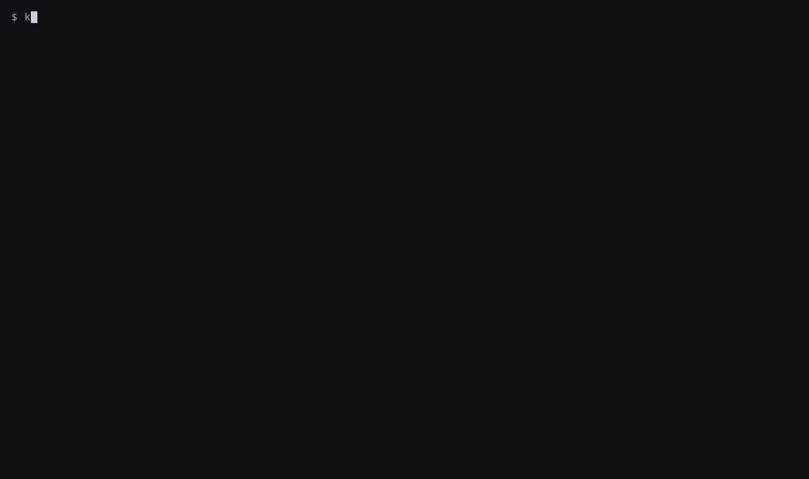
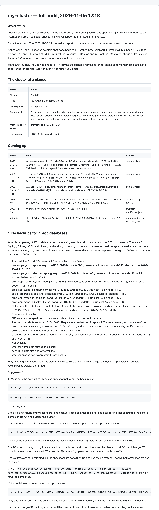
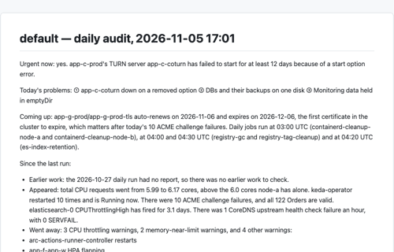

# kubegap

한국어: [README.ko.md](README.ko.md)

[](https://github.com/KyungHwanKim-devs/kubegap/actions/workflows/ci.yml) [](LICENSE)   

I built kubegap while running three clusters on my own, each on a different platform: a small k3s cluster, an EKS cluster, and Kubernetes on Azure. Alerts and dashboards catch only what someone set them up to catch. Anything else you find by digging through the cluster by hand, and I did not have time to do that on three clusters every day. So I gave that job to an AI agent.

Type `/kubegap` in Claude Code, or `$kubegap` in Codex, and the agent reads the state of the cluster, evaluates it against 407 checks in 12 areas, picks the problems that need attention now, and writes a report. Each problem comes with its evidence, its cause and how to fix it. On one EKS cluster, it found that a spot reclaim had stopped a backend for two minutes without a single alert firing.

Of the 407 checks, 112 link to public incident reports and postmortems, 207 write-ups in total, including some from Airbnb and Buffer. The links for each check are in [`docs/CHECKS.md`](docs/CHECKS.md). The remaining checks are configuration rules, and for those the report says there is no public case rather than making one up. Every problem in a report has a "Why this happens" part with the principle behind it, public cases, and official documents or books to read next, such as the Kubernetes documentation, the AWS documentation and Google's *Site Reliability Engineering*. The [EKS sample report](samples/en/eks/full/report.md) shows what this looks like.

kubegap depends on facts about other tools, such as metric names, log messages and API fields. I looked these up in each tool's source code, version by version, and cited them in [`references/sources.md`](references/sources.md). Those tables now run to more than 1,500 rows.

kubegap is a skill in the [Agent Skills](https://agentskills.io) format: a folder holding a procedure for the agent to follow and the scripts it uses. There is no server to keep running. It only reads the cluster and changes nothing. It is not a monitoring or alerting tool, and it does not fix problems for you. It finds the gaps in your cluster and in the monitoring you already have.



*A real audit. Cluster details are masked.*

## What the report looks like

A report opens with one screen: whether anything is broken right now, today's problems, and whether what the previous report asked for was done. Then the cluster at a glance (nodes, pods, namespaces, components, stores) and what is coming up (node and certificate expiries, end of support, cleanup jobs), both written by code from the snapshot. Each problem has six parts: what is happening and who is affected (only what was actually looked at), why, a suggested fix, how to roll it back, why this happens, and the evidence with the files it came from. After the problems: a table of what the previous report asked for and whether it was done, every other critical or high item in one line, and in full mode one line per area. Each step says what the cluster does when you run it, what restarts or goes down, and how to see that it worked. Before the report is written, a separate agent reads every step against the cluster objects and removes or holds what could do harm. Below is the first problem from a sample report of a full audit on an EKS cluster. Cluster details are masked. Click the image to read the whole report.

[](samples/en/eks/full/report.md)

Complete sample reports, daily and full, for an EKS cluster and a small k3s cluster are in [`samples/`](samples/README.md).



### Daily and full audits

Run the daily audit as your routine, and the full audit when you want to go through the whole cluster properly.

| | Daily audit | Full audit |
|---|---|---|
| Command | `/kubegap` | `/kubegap full` |
| When | every day | taking over a cluster, before an upgrade, a quarterly review, after an incident |
| Problems in the report | the 3 to work on today | 5 |
| Compared with | the previous daily audit | the previous full audit |
| Reads | Kubernetes objects and events, component logs, the data in Prometheus and Loki. On EKS, also the AWS inventory | everything the daily audit reads, plus the inside of the nodes, control-plane logs and the results of extra tools. On EKS, also cost and ECR |

A daily audit does not count what only the full audit collects as a problem or as a pass. The report says it was not seen.

Each audit produces two files. `report.md` is the report for people to read, and `report-details.md` has every verdict in tables. In a full audit, `report-details.md` also has the details of all 12 areas.

Scripts judge 405 of the 407 checks, so the same data gives the same result. The agent judges the other 2. It then reads the results, decides what is most urgent and writes the report. If it changes a script's verdict, it records the change and the reason in `report-details.md`.

## Which clusters it works on

kubegap runs on any cluster kubectl can read. How deep it can see depends on the kind of cluster.

| Cluster | What it can see today |
|---|---|
| EKS | inside the cluster, inside the nodes, and on the AWS side the control-plane logs, node groups, add-ons, spot and cost |
| k3s | inside the cluster, inside the nodes, and the k3s logs, etcd and datastore |
| GKE, AKS, kubeadm and others | inside the cluster and inside the nodes |

EKS and k3s came first, so they get the deepest coverage. GKE and AKS have no dedicated collectors yet, so their cloud side is not read, and I plan to extend what kubegap can see over time. Looking inside the nodes needs your permission, which is covered in [The first run](#the-first-run).

## Install and run

You will need:

- **An AI agent.** Claude Code or Codex works. So does another agent that reads the Agent Skills format and can run shell commands, such as Cursor or GitHub Copilot.
- **kubectl with read access to the cluster.** If your permissions are narrow, whatever kubectl cannot read is left out of the report.
- **python3 3.11 or newer.** kubegap's scripts are written in Python, so this is the one thing you have to install beforehand. The python3 that comes with macOS may be older.
- **jq.** If it is missing, kubegap offers to install it.
- **On EKS, the AWS CLI.** kubegap offers to install this too. Without it, the AWS side is not read.

kubegap runs on macOS and Linux, and on Windows inside WSL2.

With Node.js 22.20 or newer, one line installs it. Leave out `-g` to install it for the current folder only.

```bash
npx skills add KyungHwanKim-devs/kubegap -g
```

Without Node.js, clone the repository and create a symbolic link in your agent's skills folder. The link must be named `kubegap`.

```bash
git clone https://github.com/KyungHwanKim-devs/kubegap ~/src/kubegap

# Claude Code
mkdir -p ~/.claude/skills && ln -s ~/src/kubegap ~/.claude/skills/kubegap

# Codex
mkdir -p ~/.agents/skills && ln -s ~/src/kubegap ~/.agents/skills/kubegap
```

Then open your agent and type `/kubegap` in Claude Code or `$kubegap` in Codex. The rest of this page uses `/kubegap`. During the audit the agent may ask for permission to run commands, and at the end it gives you the paths of the two report files.

## The first run

kubegap runs without a config file, but you will not see everything from the start. How much you see depends on what is already set up in the cluster and on your machine.

Every run starts with two questions: whether you want the report in English or Korean, and whether to audit the cluster kubectl currently points at. [`docs/SETUP.md`](docs/SETUP.md) shows how to set these in advance.

With nothing configured, kubegap reads objects, events, and the logs and metrics of component pods through the Kubernetes API. If Prometheus, Alertmanager, Loki or Grafana have a Service in the cluster, it finds them and reads the metrics and logs they hold. On EKS it also reads the AWS side, using the profile in your kubeconfig or, if there is none, your AWS CLI default. If a permission is missing, only the checks that depend on that call are left out.

To see more, there are four things to decide. The agent asks only about the ones not yet set up, and you answer by picking from a list of choices. Each one says what it does and what it adds to the report, and all of them can be skipped. Until you choose, kubegap installs nothing, uploads nothing and does not connect to any node.

- **Extra tools.** These are tools kubegap runs and reads the results of, such as krr, which works out suitable requests, pluto, which finds deprecated APIs, and polaris, which checks manifests. On EKS the AWS CLI is offered here too. The agent shows which tools are missing and which checks each one feeds. They are installed only on your machine; [the table in `docs/SETUP.md`](docs/SETUP.md#optional-tools) says where each one lands and what the report says without it.
- **Checks inside the nodes.** This comes up when there is no way to reach the nodes yet. If you choose it, kubegap goes into each node and reads the disk, the kernel log and the runtime state. That is up to 26 more checks in a full audit, plus the k3s log and etcd snapshot checks on k3s.
- **Grafana token.** The dashboards and datasources that Helm put into ConfigMaps are read from there, with no token and no question. Grafana's own metric says how many dashboards exist in all; this question comes up only when Grafana holds more, which means some were made in Grafana itself, and it says how many. The agent then shows you how to create a read-only token; once you put it in the config file yourself, those dashboards join the list too.
- **Monitoring tool addresses.** This comes up when Prometheus, Alertmanager, Loki or Grafana has no Service in the cluster. If the tool runs outside the cluster, give its address. If you never installed it, say so. Loki is not asked about when your log shipper's configuration says the logs go somewhere else, such as Elasticsearch or CloudWatch Logs; the report then says so.

If you skip something, only that part is missing from the report, and the rest of the audit carries on. What kubegap could not see goes in the report under "What this run could not see" and is never counted as a pass. Skipped questions are remembered per cluster and not asked again, unless a tool or monitoring tool goes missing that was not missing before. If you change your mind, run `/kubegap setup` to choose again.

Anything to be saved to the config file is shown to you first and saved only after you confirm.

### How kubegap reaches the nodes

Node checks run in the full audit. The way in depends on the kind of cluster.

- **EKS.** Read commands run on the nodes as root through AWS Systems Manager. Your AWS account needs the SSM document `kubegap-node-read`, which fixes the commands that may run. If you choose to upload it, kubegap does that for you, and the credentials it uses need `ssm:CreateDocument`. The node role needs `AmazonSSMManagedInstanceCore`.
- **k3s, RKE2 and clusters you installed yourself.** kubegap connects with the user and key from your local SSH setup. The node's host key must be in `known_hosts`, and some logs can be read only if that user has the right groups or sudoers entries. If a node does not respond, kubegap tells you why and lets you accept the host key, enter an address yourself, or continue with the nodes that do respond.
- **GKE, AKS and other platforms with neither SSM nor SSH.** kubegap does not read the nodes there. The node checks are reported as not collected, and everything that comes from the Kubernetes API, Prometheus and node-exporter is audited as usual.

If access is already in place, kubegap reads the nodes without asking. That means the SSM document is in the EKS account, or the config file has `ssh:` or `node_access: ssh`. SSH is never used until you choose it, even where it would work. Once node access is set up, a daily audit can also read, from the nodes, the metrics of components Prometheus does not scrape.

## Commands

```
/kubegap                                         # daily audit
/kubegap full                                    # full audit
/kubegap full focus <area>                       # collect everything, analyze and report on one area
/kubegap explain <finding id> --snapshot latest  # follow one finding of the last audit down to the raw data
/kubegap --compare <A> <B>                       # run a new audit and add a comparison of earlier audits A and B to the report
/kubegap --context <name>                        # audit another context in your kubeconfig
/kubegap setup                                   # choose again what the first run asked
```

The area names for `focus` are in the table below. With `focus` on a daily audit, the checks that only a full audit collects are left out.

`explain` collects nothing new. `--snapshot latest` tells it to use the most recently collected data. Finding ids are at the bottom of the report under "Checks behind each problem", several for each problem.

For `--compare`, A and B are folder names such as `2026-11-05T08-30-12`. Each audit creates one of these folders under `~/.kubegap/snapshots/<context name>/`, with any special characters in the context name replaced by `_`. A date alone also works, but it picks the last audit of that day, daily or full. Use folder names so that daily is compared with daily and full with full.

## What it checks

There are 407 checks in 12 areas. Each check is one condition that counts as a problem. The full list is in [`docs/CHECKS.md`](docs/CHECKS.md), which also links to the public incidents behind a check where there are any.

| Area | `focus` name | Checks | Examples |
|---|---|---|---|
| Resources | `resources` | 15 | containers requesting more than 3x their 7-day p95 usage, repeated OOMKills, nodes full of requests but with single-digit utilization |
| Scaling | `scaling` | 27 | HPAs stuck at their minimum for 15 days, expired Karpenter nodes that are not replaced, KEDA external triggers without a fallback |
| Observability | `observability` | 64 | no symptom-based alerts, alerts firing for 7 days straight, a monitoring stack on emptyDir, ingress controller metrics that are not scraped |
| Traffic | `traffic` | 57 | database ports open to the internet, unhealthy ALB targets, a deregistration delay longer than the termination grace period |
| Resilience | `resilience` | 43 | replicas packed onto one node, no PDB, backup dumps on the same disk as the data, workloads that can run on only one node |
| Hygiene | `hygiene` | 35 | `latest` tags, deprecated APIs, Helm releases stuck in pending or failed, dependence on hand-applied node labels |
| Storage | `storage` | 25 | unencrypted EBS volumes, StorageClasses with expansion turned off, local-path volumes over capacity |
| Security | `security` | 46 | NetworkPolicies that are not enforced, IMDSv1 allowed, plaintext secrets in environment variables, wildcard RBAC |
| Cost | `cost` | 13 | idle compute ratio, the monthly cost of oversized requests, ECR repositories with no lifecycle policy |
| Multi-tenancy | `tenancy` | 13 | prod namespaces without quotas, NetworkPolicies or PSA, CI and prod sharing nodes |
| Node OS | `node` | 37 | disk and inodes, kernel OOMs and NIC errors, no kubelet reservations, cgroup v1, images over 3 GiB |
| Platform | `platform` | 32 | Kubernetes end of support, outdated add-ons, AMI age, service quotas near their limit, slow k3s etcd, secrets encryption turned off |

Of the 37 Node OS checks, 26 can be seen only by reaching the nodes.

Not all 407 apply to every cluster. Checks for a component such as Karpenter, Argo CD or cert-manager run only when that component is installed. A daily audit covers at most 326, leaving out the 81 that are full-only.

What is expected depends on the kind and size of the cluster. EKS is held to the production baseline. k3s, RKE2 and clusters of 3 nodes or fewer get the small-cluster baseline, which still expects backups, SLOs and an alert router, but not multi-zone spread or PDBs. You can change this with `--profile`.

## How it handles your cluster and your data

kubegap only reads the cluster. It reads pods, Deployments, events, logs and metrics, and it creates, changes and deletes nothing. It reaches Prometheus and Grafana through a port-forward, which leaves nothing behind in the cluster either.

It connects with the kubeconfig, AWS CLI profile and SSH setup you already use, and it installs nothing in the cluster.

Secret values are not collected. kubegap sees only their names and types. The `helm list` in a full audit does read the release records Helm keeps in Secrets, but kubegap keeps only details such as the release name, status and version, and does not collect the values. pluto never reaches the cluster: it checks the objects kubegap already saved, which hold no Secrets.

ConfigMap values are not stored either. kubegap keeps the length and shape of each key, and the real value only for keys it has to parse, such as the CoreDNS Corefile and the kube-proxy configuration.

Component pod logs are read by a script, which counts them by error type, keeps masked samples and deletes the originals. This happens before the agent writes the report, so the agent never sees those raw logs.

On nodes, only a fixed set of read commands runs. All of them are listed in [`deploy/node-access/COMMANDS.md`](deploy/node-access/COMMANDS.md).

Collected data is stored on your machine under `~/.kubegap/`, one folder per audit. A full audit takes about 40 MB, and `scripts/kubegap prune` removes old folders.

Every permission is listed in [`docs/PERMISSIONS.md`](docs/PERMISSIONS.md), and the collected data is described in [`docs/DATA.md`](docs/DATA.md). The ClusterRole and IAM policy for a security review are in [`deploy/permissions/`](deploy/permissions/).

## Documentation

- [`docs/SETUP.md`](docs/SETUP.md): how to connect to the cluster, AWS and the nodes, how to change settings, and how to run with the least access
- [`docs/PERMISSIONS.md`](docs/PERMISSIONS.md): what each permission is for and what you lose without it
- [`docs/DATA.md`](docs/DATA.md): what is collected, kept and sent to the model
- [`docs/HEADLESS.md`](docs/HEADLESS.md): how to run it without a person, and how to schedule it every morning
- [`docs/CHECKS.md`](docs/CHECKS.md): every check
- [`docs/DESIGN-DECISIONS.md`](docs/DESIGN-DECISIONS.md): why it is built this way
- [`CONTRIBUTING.md`](CONTRIBUTING.md) and [`references/development.md`](references/development.md): how to add or change a check

## License

MIT. See [LICENSE](LICENSE).
