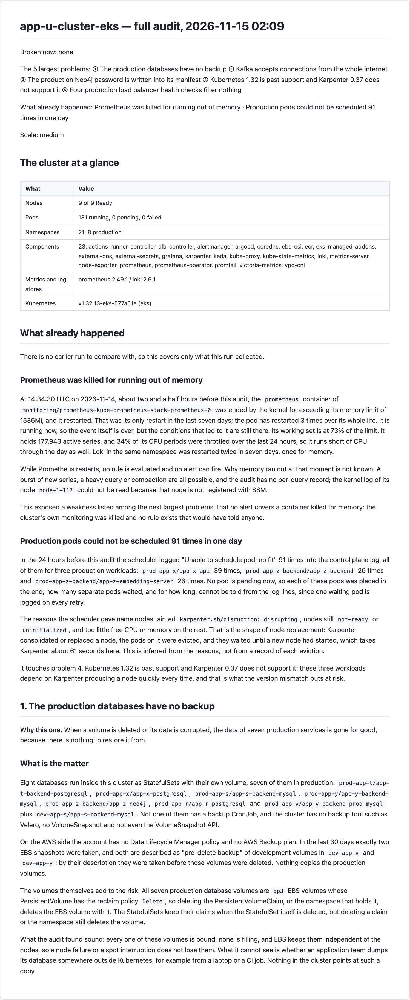

# kubegap

한국어: [README.ko.md](README.ko.md)

[](https://github.com/KyungHwanKim-devs/kubegap/actions/workflows/ci.yml) [](LICENSE)   

kubegap is a skill for AI agents that audits a Kubernetes cluster read-only and writes a report of the problems that need attention now, each with its evidence. You run it with one command inside an agent such as Claude Code or Codex.

```
/kubegap          # daily audit: 3 to 5 minutes, a report of one or two screens
/kubegap full     # full audit: reads the whole cluster in depth and writes the long report
```

- **What it looks for.** Alerts and dashboards catch what someone set them up to catch. kubegap looks at the rest: backups that never leave the cluster, alerts that reach nobody, every replica on one node, a Kubernetes version past its end of support. There are 411 checks in 12 areas.
- **What you get.** A Markdown report. It says what is broken now, what happened in the meantime and which few problems matter most, and for each of those what it is, why it matters and what to do, in the names and numbers of your cluster.
- **What it does not do.** It changes nothing in the cluster: it only reads. It runs no server and installs nothing in the cluster. It is not a monitoring or alerting tool, and it does not fix problems for you.


*The evaluate and read steps. The snapshot on screen is the test fixture committed in this repository, and every name in it is a placeholder.*

## How it works

kubegap is a skill in the [Agent Skills](https://agentskills.io) format: a folder with a procedure for the agent to follow (`SKILL.md`) and the Python scripts that procedure calls. A command runs these four steps in order.

| Step | Who | What happens |
|---|---|---|
| 1. Collect | scripts | Read objects and events with `kubectl` and query the Prometheus, Alertmanager, Grafana and Loki in the cluster. A full audit also reads the inside of the nodes and the cloud account (AWS for EKS). What was read is saved to one folder on your machine, the snapshot. |
| 2. Evaluate | scripts | Hold the snapshot against the 411 checks. A check is one rule that says "this state is a problem". Scripts decide, so the same snapshot gives the same result. |
| 3. Analyse | the agent | Read the verdicts, open the raw material of the snapshot where a verdict needs confirming, join the findings that share a cause, and choose what matters most. |
| 4. Report | the agent and scripts | The agent writes the text that explains each problem; a script checks its numbers, its links and its form and assembles the report file. A text that fails the check is not assembled. |

In no step does the agent send a command to the cluster. Only the scripts of step 1 touch it, and they run read commands only. What reaches the agent's model is what the snapshot holds, and Secret values are not read by any audit. What is stored is described under [How it handles your cluster and your data](#how-it-handles-your-cluster-and-your-data).

## Daily and full audits

| | Daily audit | Full audit |
|---|---|---|
| Command | `/kubegap` | `/kubegap full` |
| Takes | 3 to 5 minutes (2 min 30 s on a two-node k3s cluster, 4 min on a nine-node EKS cluster) | around 15 minutes (14 and 15 on the same two clusters); longer when the inside of the nodes is read |
| When | every day | taking over a cluster, before an upgrade, a quarterly review, after an incident |
| Report | one or two screens: what is broken now, what happened since the last audit, the three things that matter most | the long report: up to five of the largest problems, each explained with how it comes about, how to watch it, how it is solved at each scale, and the evidence |
| Reads | Kubernetes objects and events, metrics, counts of known failure patterns in the logs of platform components | everything the daily audit reads, plus the inside of the nodes, control-plane logs, the cloud account, application settings and the results of extra tools |
| Does not read | nodes, the AWS API, the command, args, environment values and ConfigMap keys of applications, the text of log lines | Secret values |
| Compared with | the previous daily audit | the previous full audit |

The daily audit exists for three reasons. A full audit takes long. A full audit reads the cluster in depth, and you may not want all of that on your disk and in a model. A full report holds many kinds of information, and what matters now does not stand out. So the daily audit reads less, keeps less and writes less.

What the daily audit could not judge for lack of reading is counted neither as a problem nor as a pass. The last section of its report, "What this audit did not look at", says what was not read and what cannot be known for it. What each mode reads is declared in one file, [`collectors/units.yaml`](collectors/units.yaml), and both the collection code and that section of the report follow it.

## What the report looks like

**The daily report** has this order.

1. The first screen: the titles of what is broken now, what happened since the last audit, and the three things that matter most
2. The cluster at a glance: nodes, pods, namespaces, components, version
3. What is broken now and what happened: what, when, how often, and whether it is still going on
4. The three things that matter most: for each, what it is, why it matters, what to do, further reading
5. What else is open, and what changed since the last audit
6. What this audit did not look at

**The full report** explains up to five of the largest problems in six sections each: what is the matter, why it comes about, how to watch it, how it is solved (by scale), evidence, further reading. Around them come what is broken now, what already happened, the next largest problems, what changed since the previous report, what is coming up (certificates expiring, end of support), each area in one line, and the limits of the run. It is a diagnosis with explanations, not a list of commands to type. Every verdict is in a second file, `report-details.md`, as tables.

In both reports a number in the text has to match the value in the snapshot and a link has to be one of a page someone opened and read, or the report is not assembled. A check that has public incident reports behind it carries them ([`docs/CHECKS.md`](docs/CHECKS.md)).

Below is the top of the sample full report of an EKS cluster. Click it to open the whole report.

[](samples/en/eks/full/report.md)

A daily report is this long: the k3s sample, scrolled from top to bottom.

[](samples/en/k3s/daily/report.md)

Reports from real clusters with the names replaced are in [`samples/`](samples/README.md). You choose the report language (English or Korean) when you run it.

## Install and run

You will need:

- **An AI agent.** Claude Code or Codex works. So does another agent that reads the Agent Skills format and can run shell commands, such as Cursor or GitHub Copilot.
- **kubectl with read access to the cluster.** If your permissions are narrow, whatever kubectl cannot read is left out of the report.
- **python3 3.11 or newer.** kubegap's scripts are written in Python, so this is the one thing you have to install beforehand. The python3 that comes with macOS may be older.
- **jq.** If it is missing, kubegap offers to install it.
- **On EKS, the AWS CLI.** kubegap offers to install this too. Without it, the AWS side is not read.

kubegap runs on macOS and Linux, and on Windows inside WSL2.

With Node.js 22.20 or newer, one line installs it. Leave out `-g` to install it for the current folder only.

```bash
npx skills add KyungHwanKim-devs/kubegap -g
```

Without Node.js, clone the repository and create a symbolic link in your agent's skills folder. The link must be named `kubegap`.

```bash
git clone https://github.com/KyungHwanKim-devs/kubegap ~/src/kubegap

# Claude Code
mkdir -p ~/.claude/skills && ln -s ~/src/kubegap ~/.claude/skills/kubegap

# Codex
mkdir -p ~/.agents/skills && ln -s ~/src/kubegap ~/.agents/skills/kubegap
```

Then open your agent and type `/kubegap` in Claude Code or `$kubegap` in Codex. The rest of this page uses `/kubegap`. During the audit the agent may ask for permission to run commands, and at the end it gives you the path of the report.

## The first run

kubegap runs without a config file, but you will not see everything from the start. How much you see depends on what is already set up in the cluster and on your machine.

Every run starts with two questions: whether you want the report in English or Korean, and whether to audit the cluster kubectl currently points at. [`docs/SETUP.md`](docs/SETUP.md) shows how to set these in advance.

A daily audit asks two more things at most: at what scale you run this cluster (the severity of a problem depends on it), and whether to fix the folder the snapshots go to when other users can read it. With nothing configured it reads objects and events through the Kubernetes API, and if Prometheus, Alertmanager, Loki or Grafana have a Service in the cluster, it finds them and reads them.

A full audit reads deeper, so there are four more things to decide. On EKS it reads the AWS side with the profile in your kubeconfig or, if there is none, your AWS CLI default; if a permission is missing, only the checks that depend on that call are left out. Of the four, the agent asks only about the ones not yet set up, and you answer by picking from a list of choices. Each one says what it does and what it adds to the report, and all of them can be skipped. Until you choose, kubegap installs nothing, uploads nothing and does not connect to any node.

- **Extra tools.** These are tools kubegap runs and reads the results of, such as krr, which works out suitable requests, pluto, which finds deprecated APIs, and polaris, which checks manifests. On EKS the AWS CLI is offered here too. The agent shows which tools are missing and which checks each one feeds. They are installed only on your machine; [the table in `docs/SETUP.md`](docs/SETUP.md#optional-tools) says where each one lands and what the report says without it.
- **Checks inside the nodes.** This comes up when there is no way to reach the nodes yet. If you choose it, kubegap goes into each node and reads the disk, the kernel log and the runtime state. That is up to 26 more checks in a full audit, plus the k3s log and etcd snapshot checks on k3s.
- **Grafana token.** The dashboards and datasources that Helm put into ConfigMaps are read from there, with no token and no question. Grafana's own metric says how many dashboards exist in all; this question comes up only when Grafana holds more, which means some were made in Grafana itself, and it says how many. The agent then shows you how to create a read-only token; once you put it in the config file yourself, those dashboards join the list too.
- **Monitoring tool addresses.** This comes up when Prometheus, Alertmanager, Loki or Grafana has no Service in the cluster. If the tool runs outside the cluster, give its address. If you never installed it, say so. Loki is not asked about when your log shipper's configuration says the logs go somewhere else, such as Elasticsearch or CloudWatch Logs; the report then says so.

If you skip something, only that part is missing from the report, and the rest of the audit carries on. What kubegap could not see goes in the report under "The limits of this run" and is never counted as a pass. Skipped questions are remembered per cluster and not asked again, unless a tool or monitoring tool goes missing that was not missing before. If you change your mind, run `/kubegap setup` to choose again.

Anything to be saved to the config file is shown to you first and saved only after you confirm.

### How kubegap reaches the nodes

Node checks run in the full audit. The way in depends on the kind of cluster.

- **EKS.** Read commands run on the nodes as root through AWS Systems Manager. Your AWS account needs the SSM document `kubegap-node-read`, which fixes the commands that may run. If you choose to upload it, kubegap does that for you, and the credentials it uses need `ssm:CreateDocument`. The node role needs `AmazonSSMManagedInstanceCore`.
- **k3s, RKE2 and clusters you installed yourself.** kubegap connects with the user and key from your local SSH setup. The node's host key must be in `known_hosts`, and some logs can be read only if that user has the right groups or sudoers entries. If a node does not respond, kubegap tells you why and lets you accept the host key, enter an address yourself, or continue with the nodes that do respond.
- **GKE, AKS and other platforms with neither SSM nor SSH.** kubegap does not read the nodes there. The node checks are reported as not collected, and everything that comes from the Kubernetes API, Prometheus and node-exporter is audited as usual.

If access is already in place, kubegap reads the nodes without asking. That means the SSM document is in the EKS account, or the config file has `ssh:` or `node_access: ssh`. SSH is never used until you choose it, even where it would work. A daily audit contacts no node even when access is in place.

## Commands

```
/kubegap                                         # daily audit
/kubegap full                                    # full audit
/kubegap full focus <area>                       # collect everything, analyze and report on one area
/kubegap explain <finding id> --snapshot latest  # follow one finding of the last audit down to the raw data
/kubegap --compare <A> <B>                       # run a new audit and add a comparison of earlier audits A and B to the report
/kubegap --context <name>                        # audit another context in your kubeconfig
/kubegap setup                                   # choose again what the first run asked
```

The area names for `focus` are in the table below. With `focus` on a daily audit, the checks that need material a daily audit does not read are left out.

`explain` collects nothing new. `--snapshot latest` tells it to use the most recently collected data. Finding ids are at the bottom of the report under "Checks behind each problem", several for each problem.

For `--compare`, A and B are folder names such as `2026-11-05T08-30-12`. Each audit creates one of these folders under `~/.kubegap/snapshots/<context name>/`, with any special characters in the context name replaced by `_`. A date alone also works, but it picks the last audit of that day, daily or full. Use folder names so that daily is compared with daily and full with full.

## What it checks

There are 411 checks in 12 areas. Each check is one condition that counts as a problem. The full list is in [`docs/CHECKS.md`](docs/CHECKS.md), which also links to the public incidents behind a check where there are any.

| Area | `focus` name | Checks | Examples |
|---|---|---|---|
| Resources | `resources` | 15 | containers requesting more than 3x their 7-day p95 usage, repeated OOMKills, nodes full of requests but with single-digit utilization |
| Scaling | `scaling` | 27 | HPAs stuck at their minimum for 15 days, expired Karpenter nodes that are not replaced, KEDA external triggers without a fallback |
| Observability | `observability` | 64 | no symptom-based alerts, alerts firing for 7 days straight, a monitoring stack on emptyDir, ingress controller metrics that are not scraped |
| Traffic | `traffic` | 61 | database ports open to the internet, unhealthy ALB targets, a deregistration delay longer than the termination grace period |
| Resilience | `resilience` | 43 | replicas packed onto one node, no PDB, backup dumps on the same disk as the data, workloads that can run on only one node |
| Hygiene | `hygiene` | 35 | `latest` tags, deprecated APIs, Helm releases stuck in pending or failed, dependence on hand-applied node labels |
| Storage | `storage` | 25 | unencrypted EBS volumes, StorageClasses with expansion turned off, local-path volumes over capacity |
| Security | `security` | 46 | NetworkPolicies that are not enforced, IMDSv1 allowed, plaintext secrets in environment variables, wildcard RBAC |
| Cost | `cost` | 13 | idle compute ratio, the monthly cost of oversized requests, ECR repositories with no lifecycle policy |
| Multi-tenancy | `tenancy` | 13 | prod namespaces without quotas, NetworkPolicies or PSA, CI and prod sharing nodes |
| Node OS | `node` | 37 | disk and inodes, kernel OOMs and NIC errors, no kubelet reservations, cgroup v1, images over 3 GiB |
| Platform | `platform` | 32 | Kubernetes end of support, outdated add-ons, AMI age, service quotas near their limit, slow k3s etcd, secrets encryption turned off |

Of the 37 Node OS checks, 26 can be seen only by reaching the nodes.

Not all 409 apply to every cluster. Checks for a component such as Karpenter, Argo CD or cert-manager run only when that component is installed. A daily audit covers at most 300, leaving out the 111 that need material it does not read, such as the inside of a node or the cloud account.

What is expected depends on the scale you run the cluster at. kubegap asks once per cluster: small (no dedicated SRE or DevOps engineer), medium (someone is responsible for operations and real users depend on it) or large (a dedicated team, outages hit revenue or an SLA). The answer sets how serious each finding is: a missing SLO is low on a small cluster and critical on a large one, while a missing backup is serious at every scale. Without an answer the scale is guessed from the node count and the report says so. The platform (EKS, k3s, other) is detected and only decides which checks can run.

## Which clusters it works on

kubegap runs on any cluster kubectl can read. How deep it can see depends on the kind of cluster.

| Cluster | What it can see today |
|---|---|
| EKS | inside the cluster, inside the nodes, and on the AWS side the control-plane logs, node groups, add-ons, spot and cost |
| k3s | inside the cluster, inside the nodes, and the k3s logs, etcd and datastore |
| GKE, AKS, kubeadm and others | inside the cluster and inside the nodes |

EKS and k3s came first, so they get the deepest coverage. GKE and AKS have no dedicated collectors yet, so their cloud side is not read, and I plan to extend what kubegap can see over time. Looking inside the nodes needs your permission, which is covered in [The first run](#the-first-run).

### Verified against

The facts kubegap relies on were read in the source of these components at these versions; the two reference clusters are the ones the maintainer runs. Outside a range kubegap still runs and the report header says so. Generated from `references/verified-versions.yaml` by `scripts/kubegap verified --markdown`; `references/sources.md` holds every citation.

<!-- verified-table:begin -->
| Component | Versions read in source | Reference clusters (EKS / k3s) | Assumed installation, and what happens outside it |
|---|---|---|---|
| Kubernetes (kube-apiserver, kubelet, kube-proxy, kube-scheduler, controller-manager) | v1.30.14 to v1.37.2 | v1.32.13 (EKS 1.32) / v1.33.5 (v1.33.5+k3s1) | the apiserver series are read under the job label kube-prometheus-stack gives them (`apiserver`), else a detected one — an older minor is read as is; a metric name that moved is caught by the series-presence record and the check skips naming it; the apiserver job comes from config key `apiserver_job` when detection fails |
| k3s (the embedded apiserver, kubelet, kube-proxy, flannel, kine, etcd) | v1.33.5+k3s1 to v1.37.2+k3s1 | — / v1.33.5+k3s1 | node access over SSH; the k3s-platform collector runs when the platform is k3s or rke2 — a cluster that is not k3s skips every `platform.k3s-*` check |
| containerd | v1.7.27 to v2.4.2 | v1.7.29, v2.1.5 (the two node images) / v2.1.4-k3s1 | the log signatures match the texts read at these versions; another runtime writes nothing they know |
| CoreDNS | v1.10.1 to v1.15.0 | v1.11.3 / v1.12.3 | scraped by Prometheus (`coredns_*` series) — the forward metrics moved to `coredns_proxy_*` at 1.11.0 and the queries read both spellings |
| metrics-server | v0.8.0 to v0.9.1 | v0.8.0 / v0.8.0 | — |
| node-exporter | v1.7.0 to v1.12.1 | v1.7.0 / v1.10.2 | scraped by Prometheus with the host network (the node checks join on `instance`) — a collector that is off by default (processes) is not read; the series-presence record makes the check skip |
| kube-state-metrics | v2.10.1 to v2.20.0 | v2.10.1 / v2.17.0 | scraped by Prometheus — `kube_endpoint_address` changed shape at 2.14.0 and the queries count per address |
| cAdvisor (in the kubelet) | v0.51.0 to v0.60.5 | v0.51.0 (kubelet 1.32) / v0.52.1 (kubelet 1.33) | scraped through the kubelet's cadvisor endpoint |
| Prometheus | v2.49.1 to v3.15.1 | v2.49.1 / v3.7.3 | a Service kubegap can port-forward to (kube-prometheus-stack's, or `prometheus_url` in config) — no Prometheus: every metric check skips with the reason, the report says so in section 7 |
| Alertmanager | v0.26.0 to v0.34.2 | v0.26.0 / v0.29.0 | a Service kubegap can port-forward to — no Alertmanager: the alerting checks skip |
| kube-prometheus-stack / prometheus-operator | kube-prometheus-stack-56.0.0 to kube-prometheus-stack-92.18.0 | chart 56.0.0, operator v0.71.0 / chart 79.5.0, operator v0.86.2 | the chart's job labels (`apiserver`, `kubelet`, `node-exporter`, `kube-state-metrics`) and Service names — other job names: the apiserver job is detected or set in `apiserver_job`; other Service names: `prometheus_url` in config |
| Grafana | v10.2.3 to v13.3.0 | v10.2.3 / v12.2.1 | dashboards and datasources read from the sidecar ConfigMaps, or from the API with `grafana_api_token` |
| Loki and promtail | v2.6.1 to v3.7.9 | Loki v2.6.1, promtail v2.9.2 / — | a Loki Service kubegap can port-forward to; promtail or Fluent Bit as the agent — no Loki: the log-volume checks skip; another agent is detected or not |
| Fluent Bit | v3.0.4 to v5.1.5 | — / v3.0.4 | scraped by Prometheus (`fluentbit_*`) |
| ingress-nginx | controller-v1.12.1 to controller-v1.15.1 | — / controller-v1.14.0 | metrics scraped by Prometheus (`nginx_ingress_controller_*`) — without the scrape the per-Ingress traffic checks skip (ingress metrics not read) |
| Traefik | v1.7.34 to v3.7.17 | — / — | no Traefik runs on either reference cluster; metrics scraped by Prometheus when it does |
| MetalLB | v0.12.1 to v0.16.2 | — / v0.14.5 | speaker metrics read from the pods through 0.15; status objects (ServiceL2Status from 0.14.6, BGPSessionState of frr-k8s mode from 0.15.2) after — native mode on 0.16+ and FRR mode: the BGP session state is read only where Prometheus scrapes it |
| Argo CD | v2.13.0 to v3.6.1 | v2.13.0 / v3.2.0 | controller metrics read from the pods; ConfigMap keys `argocd-cm`, `argocd-cmd-params-cm`, `argocd-rbac-cm` |
| cert-manager | v1.14.4 to v1.21.3 | — / v1.14.4 | controller metrics read from the pod |
| External Secrets Operator | v0.9.13 to v2.14.0 | v0.9.13 / v2.1.0 | controller metrics read from the pod |
| KEDA | v2.12.0 to v2.21.0 | v2.17.2 / v2.19.0 | operator metrics read from the pod (`--enable-prometheus-metrics`) — metrics off: the KEDA metric checks skip, the step says why |
| Reloader | v1.4.23 | — / v1.4.14 | — |
| Elasticsearch / OpenSearch / Kibana | v7.10.2 to v9.5.6 | — / Elasticsearch v7.10.2 | log signatures only |
| Karpenter | v0.37.0 to v1.15.1 | v0.37.0 / — | NodePools and NodeClaims through the API, controller metrics from the pod — no Karpenter: the `karpenter.*` checks skip (kind not served) |
| AWS Load Balancer Controller | v2.7.2 to v3.6.2 | v2.7.2 / — | TargetGroupBindings through the API; ALB metrics from CloudWatch (`elasticloadbalancing:Describe*`, `cloudwatch:GetMetricData`) — AWS calls refused: the ALB checks skip naming the call |
| EBS CSI driver | v1.37.0 to v1.67.2 | v1.37.0 / local-path-provisioner v0.0.31 | controller metrics scraped by Prometheus — the `aws_ebs_csi_*` names exist since v1.38.0; before that the `cloudprovider_aws_*` names, and the queries read both |
| VPC CNI (aws-node) | v1.19.0 to v1.23.2 | v1.19.0 / — | ipamd metrics read from the pods or through the node; the add-on configuration from `eks:DescribeAddon` — metrics not read: the IP-exhaustion checks skip |
| external-dns | v0.14.0 to v0.24.0 | v0.14.0 / — | log signatures only |
| Actions Runner Controller | gha-runner-scale-set-0.10.1 to gha-runner-scale-set-0.15.1 | gha-runner-scale-set-0.10.1 / summerwind actions-runner-controller v0.27.6 (the legacy controller) | component detection only |
| cluster-autoscaler | cluster-autoscaler-chart-9.60.0 | — / — | component detection only |
| Operating system of the nodes (systemd, kernel, glibc, coreutils, procps, smartmontools) | systemd v255, kernel v6.12 | Amazon Linux 2 (systemd 219, kernel 5.10) and Amazon Linux 2023 (systemd 252, kernel 6.1) / Ubuntu 22.04 (systemd 249, kernel 5.15) | the node scripts run over SSM or SSH — no node access: the 36 `node.*` checks skip |
| Go runtime and standard library (strings every Go component relays) | go1.21.0 to go1.26.10 | go1.24.13 (kubernetes 1.32) / go1.24.6 (kubernetes 1.33) | — |
| krr | v1.31.1 (the pin of `kubegap setup`) | v1.31.1 / v1.31.1 | installed by `kubegap setup`, pinned with a sha256 — not installed: the `resources.*` KRR checks report tool-missing |
| polaris | v10.2.6 (the pin of `kubegap setup`) | v10.2.6 / v10.2.6 | installed by `kubegap setup`, pinned with a sha256 — not installed: tool-missing |
| pluto | v5.24.5 | v5.24.5 / v5.24.5 | installed by `kubegap setup`, pinned with a sha256 — not installed: tool-missing |
| kubent | 0.7.3 | 0.7.3 / 0.7.3 | installed by `kubegap setup`, pinned with a sha256 — not installed: tool-missing |
| helm | v3.22.1 to v4.3.1 | v4.3.1 / v4.3.1 | installed by `kubegap setup`; `helm list` needs the Secrets the shipped ClusterRole does not grant — the two Helm checks skip with the reason |

71 facts in references/sources.md are marked unverified: observed on the reference clusters, not read in source.
<!-- verified-table:end -->

## How it handles your cluster and your data

kubegap only reads the cluster. It reads pods, Deployments, events, logs and metrics, and it creates, changes and deletes nothing. It reaches Prometheus and Grafana through a port-forward, which leaves nothing behind in the cluster either.

It connects with the kubeconfig, AWS CLI profile and SSH setup you already use, and it installs nothing in the cluster.

Secret values are not collected. kubegap sees only their names and types. The `helm list` in a full audit does read the release records Helm keeps in Secrets, but kubegap keeps only details such as the release name, status and version, and does not collect the values. pluto never reaches the cluster: it checks the objects kubegap already saved, which hold no Secrets.

ConfigMap values are not stored either. kubegap keeps the length and shape of each key, and the real value only for keys it has to parse, such as the CoreDNS Corefile and the kube-proxy configuration.

The logs of platform component pods are read by a script, which counts how many lines match each known failure pattern while it reads. No log line is written to the snapshot as it was. A full audit keeps up to five masked sample lines per pattern; a daily audit keeps the counts only.

A daily audit does not keep how your applications are configured either. Outside the system namespaces (the platform components, such as `kube-system` and `monitoring`), the command and args of containers, environment values and ConfigMap keys are dropped before a file is written.

On nodes, only a fixed set of read commands runs. All of them are listed in [`deploy/node-access/COMMANDS.md`](deploy/node-access/COMMANDS.md).

Collected data is stored on your machine under `~/.kubegap/`, one folder per audit. A full audit takes about 40 MB and a daily one about 20 MB, and `scripts/kubegap prune` removes old folders.

Every permission is listed in [`docs/PERMISSIONS.md`](docs/PERMISSIONS.md), and the collected data is described in [`docs/DATA.md`](docs/DATA.md). The ClusterRole and IAM policy for a security review are in [`deploy/permissions/`](deploy/permissions/).

## The public reports behind the checks

The 209 case links in [`docs/CHECKS.md`](docs/CHECKS.md) point at reports other teams published about their own incidents. Most of them are also in [Incident Library](https://benchlet.com/incidentlib/app), a public collection where each report is written up as one case with its symptoms, trigger, root cause, components and lessons, in English and Korean, and the cases can be searched by a symptom sentence. When a report says "Zalando 2019" next to a check, the library has the same report as a case with a stable number, and the CHECKS.md row links to it.

The library is open to AI tools too: an HTTP API at https://incidentlib-api.benchlet.com and an MCP server at https://incidentlib-mcp.benchlet.com/mcp, both without a key. An agent that has just read a kubegap finding can ask the library which public incidents had the same symptoms.

## Documentation

- [`docs/SETUP.md`](docs/SETUP.md): how to connect to the cluster, AWS and the nodes, how to change settings, and how to run with the least access
- [`docs/PERMISSIONS.md`](docs/PERMISSIONS.md): what each permission is for and what you lose without it
- [`docs/DATA.md`](docs/DATA.md): what is collected, kept and sent to the model
- [`docs/HEADLESS.md`](docs/HEADLESS.md): how to run it without a person, and how to schedule it every morning
- [`docs/CHECKS.md`](docs/CHECKS.md): every check
- [`docs/DESIGN-DECISIONS.md`](docs/DESIGN-DECISIONS.md): why it is built this way
- [`CONTRIBUTING.md`](CONTRIBUTING.md): how to add or change a check, the test commands, the pull request rules and the review checklist. [`references/development.md`](references/development.md) has the mechanics behind them

## License

MIT. See [LICENSE](LICENSE).
